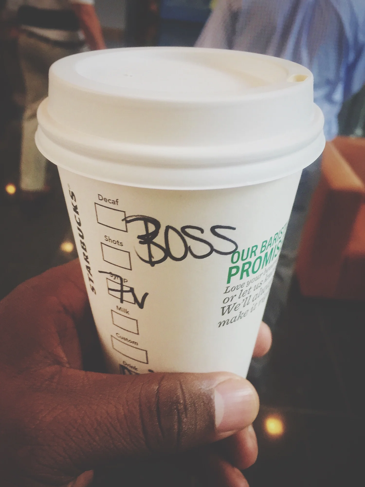

I’m a social drinker, my coffee break partner(s) and I opine about life and all of its ironic twist on a regular. The theme over this past week has been about things living souls are unwilling to do for balance, peace, healing, and/ or love.

I Am generally protective about my "system" for getting things done. Life in general I remain humble however I can be particular about how I organize and accomplish what I set out to do.

**Of Work**

I sat in on a panel discussion with various managers and officers as they discussed their early career and how they have advanced throughout the past few years. All things considered, probably something I could have missed. I disconnected from the conversation because it felt disingenuous. Only one person stood out as honest and real.

**Of Home**

I spend a lot of time on practical matters and keeping things in order. Although to my wife & kids this might read: nitpicky and critical. It is a sensitive position to be in, either I’ll go insane or I’ll push them to it.

**Of Fitness**

On occasion I’m asked how I stay motivated to get up and workout at 4 in the AM every day. I usually respond with the “make it a habit” speech, however for me it is about that system for getting things done.

I’m a very sad sight when there is nothing to do. I derive energy from the things I do when at work, at home and while working out. At times, I have a tendency to take on too much (read: saying no.) There is a nervous energy when I’m not producing anything, and a nervous energy about whether what I’ve produced will measure up.

**Change Won’t to Will**

I won’t hang around negative people, I will be more genuine.

I won’t prioritize perfection (because it does not exist,) I will be more patient.

I won’t say yes unless I really want to, I will say no.

I Am

