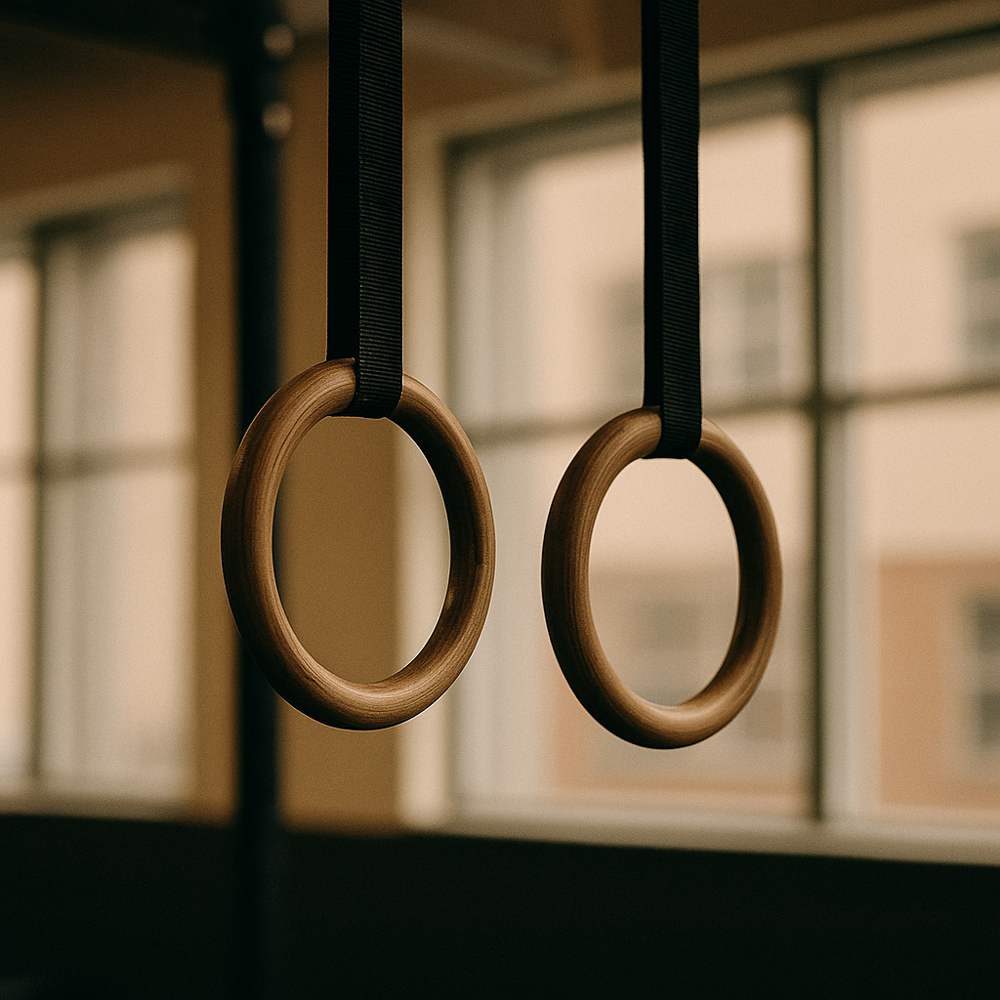

**Willing. Becoming.**

“Won’t” is fear dressed in reason. “Will” is clarity dressed in courage.

I’ve said “won’t” a hundred ways: *Not now. Maybe later. I can’t.* But when I stopped negotiating with hesitation and just moved something shifted. “Will” doesn’t require certainty. It only asks for presence.

This isn’t blind optimism. It’s practiced belief. Daily reps in resilience. Choosing will, even when the weight is heavy.

That’s how you build trust in yourself,

I Am

