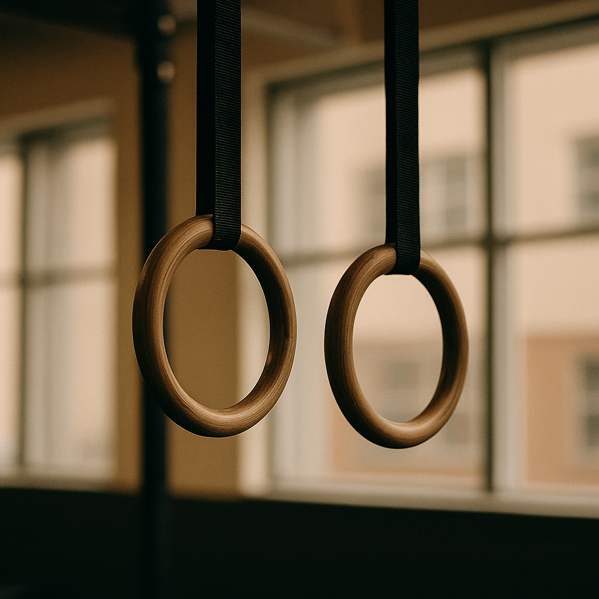

**Grounded & Lifting**

Every stumble holds the seed of a lift.

Falling isn’t failure, it’s data. It’s direction. It’s how the ground reminds you you’re still here. Rise isn’t always loud. Sometimes it’s a whisper. A toe flex. A breath.

I used to measure growth by how far I could go without falling. Now I measure it by how gracefully I get back up. Knees scraped, pride bruised and spirit intact.

This calisthenic isn’t about avoiding the fall. It’s about training your rise,

I Am

