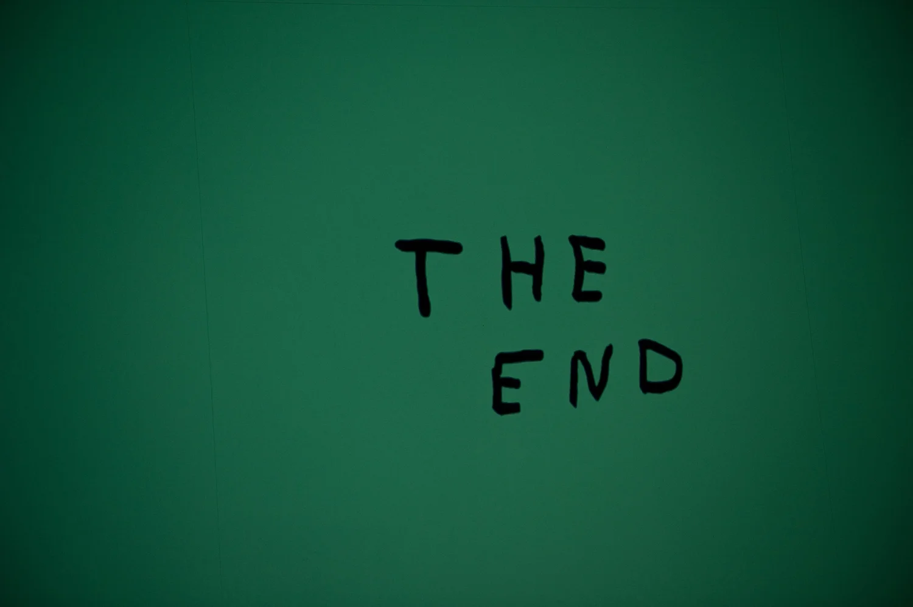

*"Blogging: Or writing in general. In my heart, there is an epic writer. But in my head there is an epic procrastinator. I think about writing every day. I want to blog..." ~**September*

Inspired by the [legend](http://www.neatorama.com/2012/11/08/A-Six-Word-Short-Story-by-Ernest-Hemingway/) of the six word story, motivated by a desire to write.

### **Karma supplies me two days’ notice.**

Whether you believe there is karmic debt or believe the ideas of reward and punishment are human concepts.

The likeliness that an event will occur is probable, stay ready.

### **We go hard, no days off**.

Health is the vital principle of happiness, and exercise of health.

Every day, move.

### **First we decide, then we justify.**

Unlike when we deceive and then we deceive about the fact that we deceive. A lie.

Once we ourselves believe – we get on with the business of justifying.

### **Count your blessings, not your problems.**

I’ve told y’all this before… I know people who text me to complain, often daily, and they do not want advice. Even when they are fortunate enough to have a problem with a clear solution, they ignore it and continue to complain.

### **Remember me, like I remember you.**

There are some moments you cannot escape.

[The die is very strong.](http://tramuel.com/iam/2013/02/12/77-on-77?rq=memory)

### **Even you have limitations. Recognize them.**

Sometimes we’re too dependent on ourselves and our own strengths.

### **Love is easy, relationships take work.**

My God.

### **She is feeling, he is thinking.**

Men think before they feel? or women feel before they think?

Questions that need answers.

I remain
