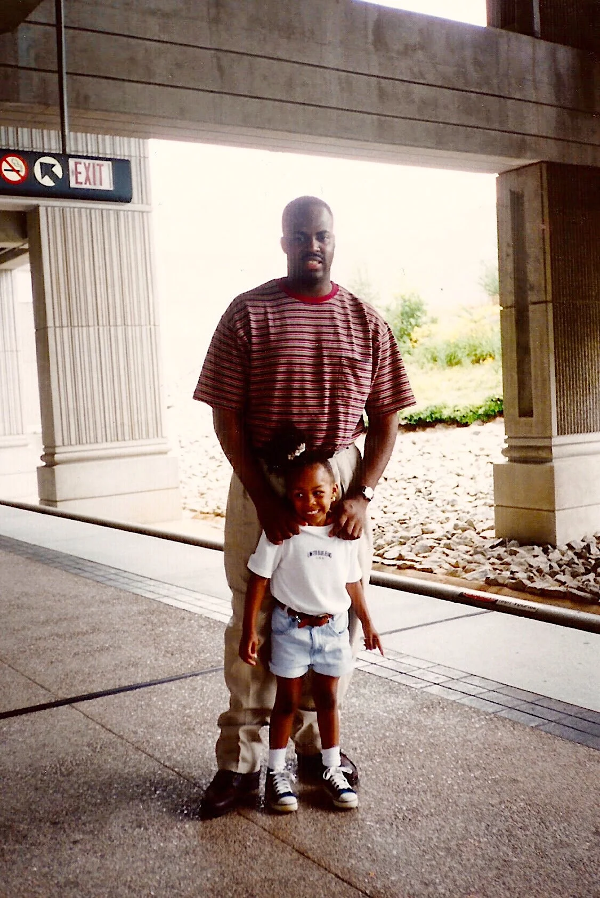
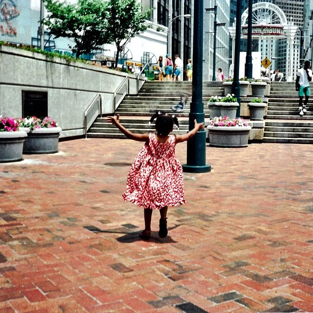
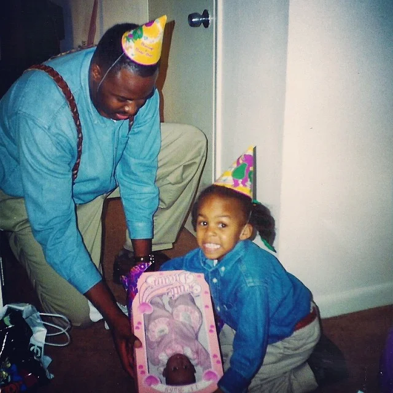

I recently started using Proton Mail, it provides end-to-end encrypted email through a web interface and mobile app. It will replace all other clients for me and I’ve started to delete my footprint(s) on Yahoo, Outlook and Gmail – In that process I came across my responses to a series [Sunny](https://unreseredlyme.com/) did for her blog where she asked

### "*Are you more like your mom or your dad?  In what way?"*

My response:

*I Am more like my mom, she is a reader, thinker and writer. While I write for personal expression & generally don’t share. She writes with passion that should be shared. I also inherited a list of ‘opportunities’ such as a big upper body, small lower body ;) Physically we are alike too.*

What stands out to me as I read over the above response and the whole of my responses is

### *While I write for personal expression & generally don’t share.*

Although, everything you read or see in my social media streams are real, there are things that I choose not to share. The stuff where I’m disappointed in myself.

One of the most common causes of self-defeat (meaning failure in our careers, self-regulation or relationships) is the expectation that others will see us as a disappointment.

& honestly, I’m not sure how my daughter Davina views me and this has been a constant struggle for me, especially as I’ve always ‘talked’ about having a better relationship with her.

& never moving forward into action.

Davina, aka Dorian (long, funny story) has always excelled in school, is very studious and amazingly grounded as she grew up with too very young parents who were also growing up. I was twenty years young when she was born. The blessing is and has been a very large extended family. To this day, there are aunts, uncles, cousins and grandparents that are there to provide help and support should she need it. She has taken great care to care for herself and we are all very proud of the woman she is.

Through child support payments I was able to provide for (some of) her financial needs, the most painful aspect of this emotional attachment is a sense of being a disappointment to myself for not providing for her emotional needs as well.

**Time and distance creates space.**

I moved to Georgia, my older sister saving me from myself, when Dorian was two. Time and distance; 6 h 33 min (434.4 mi) via I-77 S and I-85 S. There are times where I shined inside of that space, where I did the best I was able to - at the time. There were summers spent with us, trips back home and a trip or two to Ohio as she and her mom moved away to save themselves from the hole that Roanoke can sometimes be for young people trying to make a living (& life) for themselves.

Still – I didn’t do enough within that space to provide stability, comfort and security.

Dorian looks a lot like her mother, however The Tramuel is strong with her as apparent in a lot of her physical characteristics, the most famous - our trademark high-forehead, the following is also true

### *I also inherited a list of ‘opportunities’ such as a big upper body, small lower body ;) Physically we are alike too.*

There is no ending to this but an honest beginning to creating a better relationship with Dorian.

I Am

For fun, here are the additional questions and my responses to Sunny.

**What simple gesture have you recently witnessed that renewed your hope in humanity?**

*Love.*

*I don’t need examples from high profile celebrities or the first family (The Obamas - not that @$%# currently in office). I have aunts, uncles, a sister & parents that have been together for decades. Love being one of the main characteristics of human beings renews my hope*.

**Are you happy with where you are in your life?  Why?**

*I Am. I’m in a good emotional, spiritual, physical and mental place. All of my needs are met; I’m working on the wants.*

**What is your greatest strength and your greatest weakness?**

*My greatest strength is having a strong sense of responsibility. I shine when I serve others in some way. Having a fear of not meeting others expectations is a weakness.*

**What is your earliest childhood memory?**

*Climbing into my grandmother’s bed during a storm. I still feel her embrace, hands rubbing my back. & her sweet voice … “I want you to go the fuck to sleep.”*
