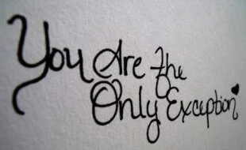

## Retrospection

In previous relationships I found myself daydreaming/ planning ahead. Those dreams were always exclusive to the three of us; and by us I mean me, myself and I. Thats not meant to take away from anyone I've dated. I've written before how fortunate I've been to have loved and been loved by some incredible women.

## Introspection

Now I daydream of The Future. A common theme is of growing older; sitting on the porch now involves two rockers instead of one, that motorcycle is now a two-seater, and trips now include reservations for two.

I've slowly stopped saying my and learning to say our... with exception to my kitchen utensils, my electronic(s) and my book(s).

I Am
