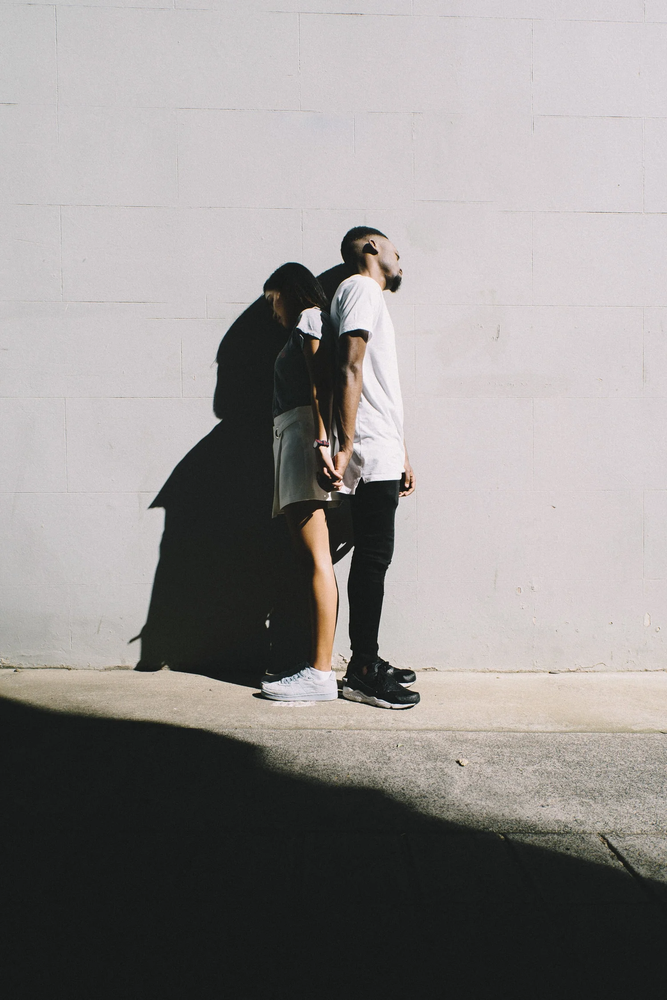
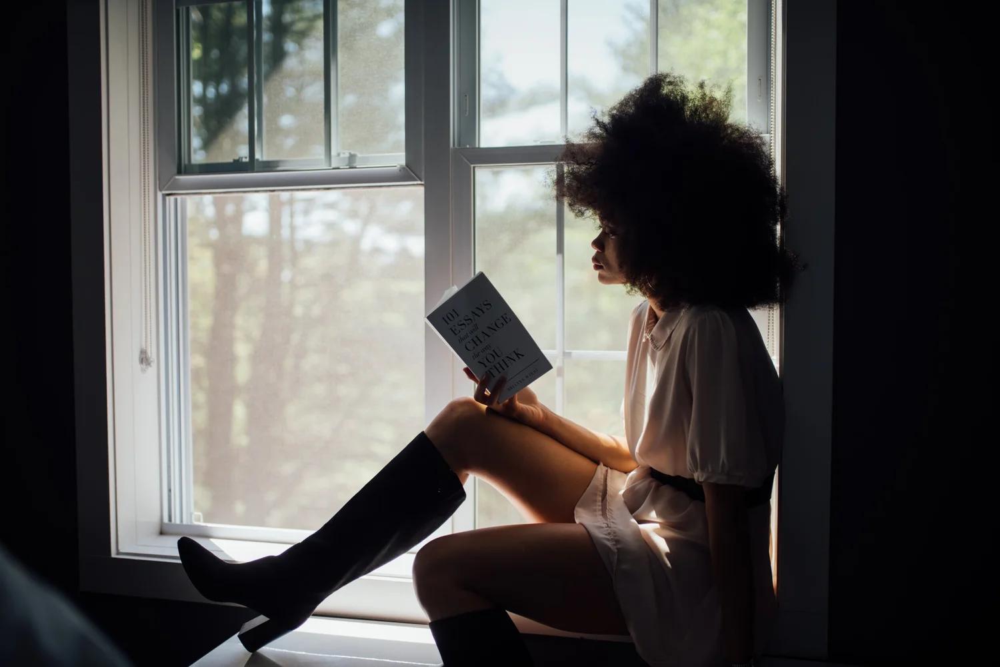

I had a signal reaction to hearing (for a third time) someone say that they believed they were not good enough for me.

### A whole me

There is NOT nothing I have been through or experienced where I believe myself to be above anyone, while I have a (very) strong sense of my lovability, capability, and worthiness I would never believe myself to be greater than. That signal reaction led me to really consider why. I believe in the Sun, the Moon, the Stars and shit - no, not the band or the book but the actual celestial bodies - so I looked to the sky to see if I could uncover the moral and intellectual crisis of our time

### My Ego

*“Although Virgo-Librans periodically need to indulge their sense of touch, they may appear removed or untouchable themselves, and may only allow physical contact at special times.”*

After a zero to one hundred, real quick search on the innanets’ I found that quote, remember that context communicates as strongly as content;

“… *they may appear removed or untouchable themselves and may only allow physical contact at special times.”*

A short story starring me.

*“Many born on the cusp are content to admire beauty from a distance, seeing it as a quality to be adored or worshiped from afar, rather than one to approach or possess.”*

At this point, I’m now engaged in emotional calisthenics and counterweights have been attached to all of my feelings.

I’ve made a great effort (lately) to listen to the subtext when people speak; checking their facts, feelings, values and opinions … so I believe I understand why someone would believe they are; the correct phrase is

*Underserving of love*

This is neither a boost to nor an attack on my ego but a mirror reflecting back,

[In To Me See](http://tramuel.com/iam/in-to-me-see?rq=intimacy)

Whew, that post

That whole post.

We all deserve to be loved.

We all deserve to be seen.

We all deserve reciprocity.

I remain
