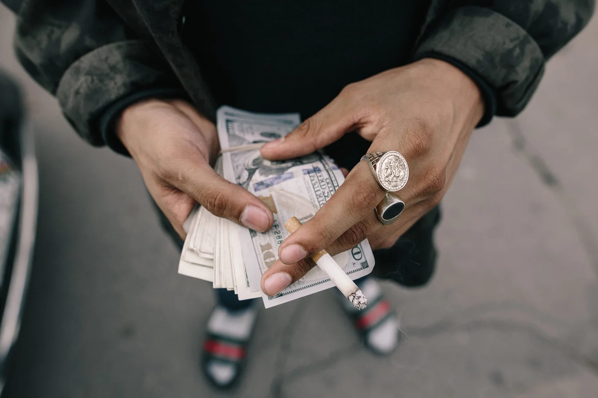
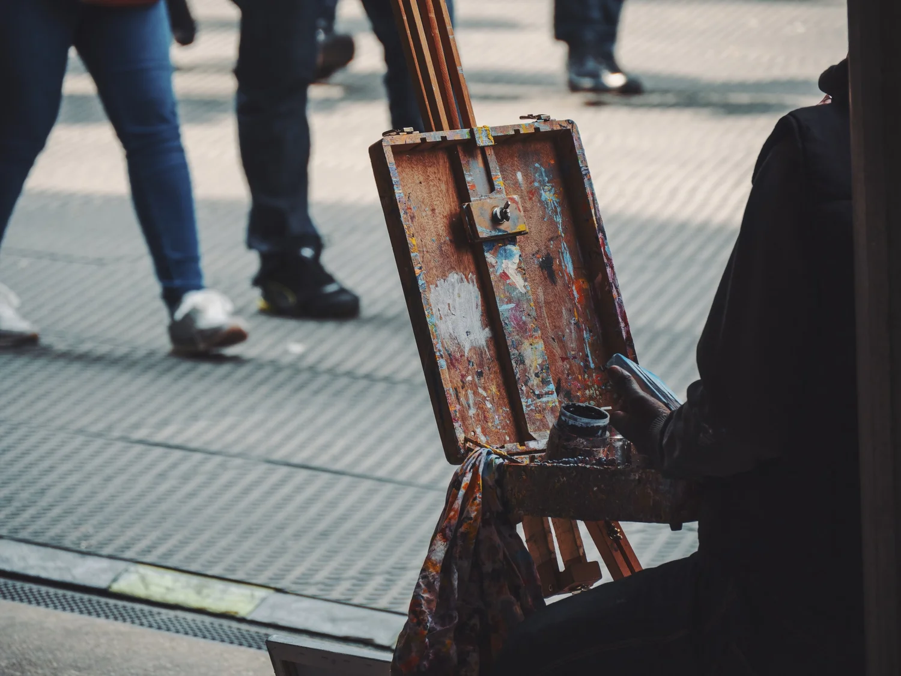

The other day while having a discussion about Cash Rules Everything Around Me, CREAM get the money, dollar, dollar bill Y'all. It led to a familiar discussion that I’ve been having with greater than enough frequency lately, living souls being obsessed with making the greatest amount of money with the least possible effort.

I like money, but I’ve learned it cannot make you happy. In the words of the prolific rhymer Christopher George Latore Wallace, Mo Money Mo Problems. Also, I would sign up for a test to see if $500MM would indeed make me happy – it is a delicate duality to balance.

Upon further discussion, it occurs to me that people want social fame and the perceived wealth that comes along with it. Most believe they are influencers but are merely repeating or mimicking content that creators *create*.

### Creators gonna’ create.

Seeing someone else draw or paint might inspire me but I’m not going to make money through artistic pursuits because I cannot draw or paint. So what I’m going to do is avoid the potential pitfalls of putting too much faith in ideas that don't have enough grounding in reality.

### Quality vs quantity.

I use social media for inspiration, although I like to have my own ideas about things I do appreciate my connections and look to them for creativeness.

### Real recognize real.

I do not follow any celebrities; real or faux. I instead look to people who breathe the same air as me. Drink Dasani bottled water when Walmart is out of Aquafina because we pause before (every single time) reaching to turn on the tap, pondering if the water from our faucet is safe to drink.

I know people who (try) to do what they have learned in a single blog post, book or from a Youtube channel. I’m not speaking negatively about the try, I’m speaking negatively of the expectation that you can achieve the same level of success overnight. It just seems that the respect for actually doing something is fading - & by doing something, I mean building a solid foundation organically to achieve your goals.  Being a social media influencer is now equivalent to years of hard work, effort and building connections.

Don't follow the footsteps, create them.

I remain.
