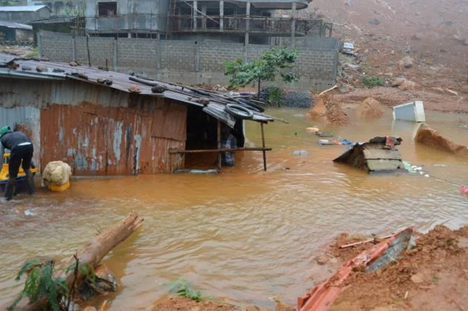

Seeing; over consuming beyond a scope that is necessary.

Hearing; water rushing in, panic in their voices

Tasting; salt water and dirt

Touching; personal device screens – iPad, iPhone… swiping up, down, left, right

*Still over consuming,*

Feeling; empty

