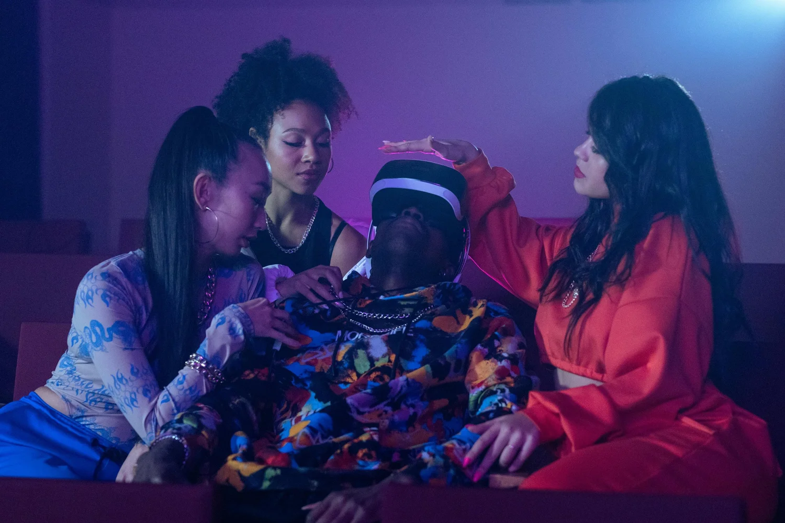

### **The Strategist**

After my divorce, I’ve approached dating with a mindset of understanding, patience, and respect for boundaries. I’ve tried to meet women where they are—whether it’s respecting their preference not to meet for coffee on a first date or pursuing them even when the energy isn’t reciprocated. I’ve believed in the value of effort, hoping it would lead to genuine connections. Null, that approach hasn’t worked.

### **The Mastermind of Complexity**

I fully understand that relationships are complex. Everyone has their reasons for how they choose to engage. Maybe it’s past experiences, personal preferences, or societal conditioning that shape how people behave in the dating world. I’ve done my best to navigate this with compassion, even when situations feel unbalanced.

### **The Challenger of Inequity**

After a few experiences where my efforts felt like they fell into a void, I wondered why I would keep trying to play the “helpful role” in a system where energy isn’t equally shared. Why cater to people who haven’t made their interests clear?

*Please don't answer; it was rhetorical.*

### **The Irony Detector**

I've noticed something ironic. While I prioritize expressing my lack of interest early on if I don't feel a connection, some women continue to pursue me despite my clarity. On the other hand, when I genuinely express interest in someone, the signals I receive are often vague or, worse, completely absent. This leaves me wondering not only where I stand but also why we continue engaging when we are not on the same page.

### **The Rejection-Proof Alchemist**

*Mr. TramueL may not be right for everyone; consult your therapist to see if he is suitable for you.*

Honestly, I don’t take rejection personally. If someone isn’t interested in me, that’s perfectly fine—I respect their decision. What I don’t understand is the reluctance to communicate disinterest. Why waste time? For both of us, the sooner we express where we stand, the sooner we can move on. Even the best architects sometimes choose demolition over renovation. Heroes grow weary, and when civility collapses, you might find that the rejected hero becomes the antagonist of a story they write themselves. So speak your truth quickly. Otherwise, I might just build a whole empire on the silence and "Darth Vader" my way to the top.

### **The Reclamation Artist**

The two of you reading this know me well enough to understand that I’m not becoming an actual villain. I’m not abandoning my decency or planning to treat others poorly. What this means is that I’m done prioritizing the feelings, boundaries, and needs of others at the expense of my own.



### **The Energy Balancer**

In the past, I’ve tried to accommodate people I barely knew, hoping that my efforts would lead to a connection. However, this approach often left me feeling drained and unappreciated. Moving forward, I will prioritize my wants, needs, and desires.

### **The Advocate for Clarity**

No More Guessing Games. If someone can’t express their interest or disinterest clearly, I won’t linger in ambiguity. I’ll move on.

### **The Keeper of Reciprocity**

Matching Energy. I’ll only invest effort when it’s reciprocated. If someone isn’t meeting me halfway, I won’t overextend myself to meet them where they are.

### **The Time-Lord**

Reclaiming My Time. I’ll prioritize experiences and people who align with my values and intentions.

### **The Hero of Self-Preservation**

It’s about creating space for connections that feel authentic and mutual rather than one-sided and uncertain. This arc is less about becoming a bad guy and more about shedding the role of the overly accommodating one. It’s about valuing my time, energy, and emotional well-being enough to demand the same in return.

### **The Ultimate Power Move**

After all, isn’t that the real superpower?

*Please don't answer...*



Y'all know the rest,

I Am
