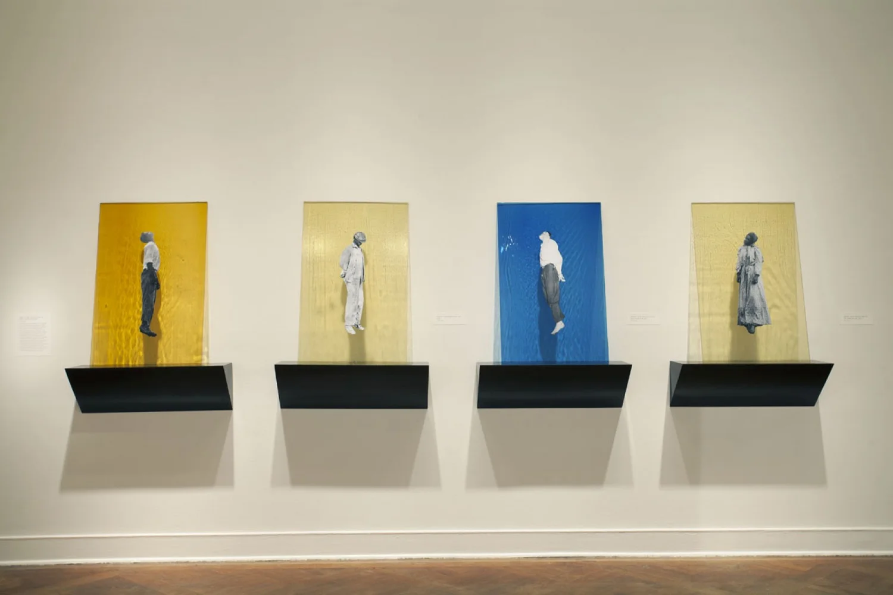

## Nigga & Nigger

I've become hypersensitive to the n word. I’ve used it among a very small circle of friends but have since stopped because it pull(s)(ed) at me. I’ve never joined the debate; reversing the power vs. the belief it’s impossible to separate the word from its repulsive racial past.  
  
The majority of the living souls I'm connected with in these social and real streets do not use it, at least not on their timeline or publicly. Although this is a very public debate, I view it as a highly personal choice for an individual.  The same as individuals with opposing views have a choice to stay or not stay connected, to support or not support another individual or collective.  
  
Having no issue with its use in any of my relationship(s); family, love, friends, vocation or social, the problem for me is the words use in music. The playlist(s) on my phone power my run/ workout and are filled with the hardest driving hip-hop beats and rhymes. I admire rappers [& comedians] use of metaphors and word pictures however I believe they can add color and power to their language without using the n word.

See, nigga first was used back in the Deep South

Falling out between the dome of the white man's mouth

It means that we will never grow, you know the word dummy

Upper niggas in the community think it's crummy

But I don't, neither does the youth cause we embrace

Adversity it goes right with the race

And being that we use it as a term of endearment

Niggas start to bug, to the dome is where the fear went

Now the little shorties say it all of the time

And a whole bunch of niggas throw the word in they rhyme

Yo I start to flinch, as I try not to say it

But my lips is like the oowop as I start to spray it

My lips is like a oowop as I start to spray it

Q-Tip, A Tribe Called Quest

###

### The pull is discernment.

##

## Of reversing the power

The Future purchased an Infiniti QX4, during our first attempt at love. Thirty day tags fresh, I’m driving… doing 45 on 160. I approach the traffic light at the intersection of 160 and Westinghouse Blvd, a Saturn in front of me and a Suburban behind me. We all make a left turn; as we approach a set of train tracks the Saturn slows to an almost complete stop to clear the tracks, the Suburban lays on its horn. As we approach 49 the Saturn slows again to make a right turn into a shopping center, here the road breaks from one lane to three. The suburban being driven by an unknown white male pulls beside us and yells “It ain’t a Cadillac nigger.” I laughed, because my beach is better. I Am usually perceptive and not easily rattled or surprised in life. I Am not a do-gooder nor am I a law-breaker. However, I'm not afraid of the dark side of human nature. Had The Future, young Geneva and infant Brian not been along with me in the truck there may have been a different response.

To that point, he was riding with whom I’ll assume is/ was his family; wife and two preteen kids, a girl and a boy. All seemed unplaced by his aggression and word choice.

##

## Of separating the word from its repulsive racial past

Understanding the intent was meant to offend me the way it was used for centuries by degrading and stripping “us” of our humanity in front of our families.

###

### It was however powerless.

I could make the argument that my exposure [and/ or overexposure] through music [& comedy] desensitized the brunt of the word. I’ll leave that for society’s edicts to debate, all I have is a conscious decision not to use it.  
  
I’ve read a few blog post and online articles concerning the use or non-use of the word, most recently as it relates to the NFL’s proposed decision to ban and a post on [The Good Men Project.](http://goodmenproject.com/arts/why-the-n-word-is-cool-to-black-people-and-no-one-else-grgs/?utm_source=feedly&utm_reader=feedly&utm_medium=rss&utm_campaign=why-the-n-word-is-cool-to-black-people-and-no-one-else-grgs) I would caution you, whatever point of view you hold, to be mindful of those who substitute the absorption of media for real life experiences and use them in a way that other people would normally use their own personal experiences to compare, contrast and discuss a subject with another person.  
  
The sudden and unexpected end.

Glass with cutouts of lynchings Martyrs, 2011 Strange Fruit - Hank Willis Thomas

I Am
