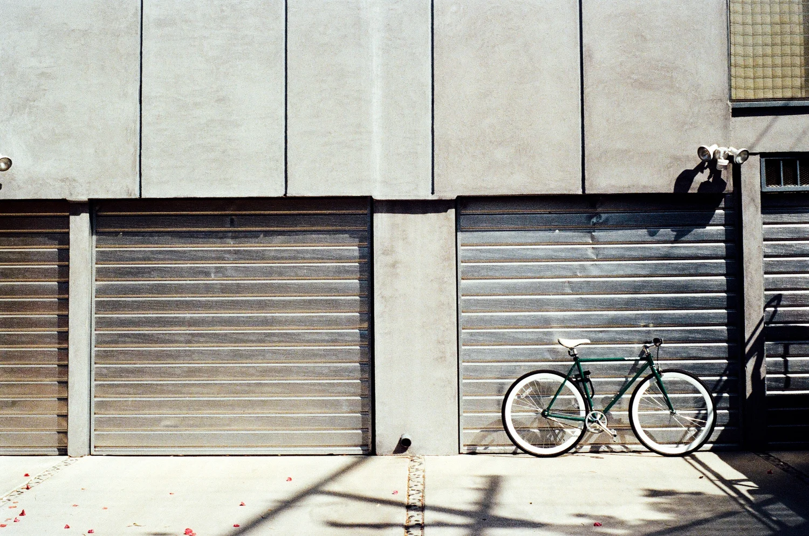

I've written previously that I ride CATS [Charlotte Area Transit System] to and from work everyday. Also that I purchase a 10 ride local pass.  Yesterday on the evening ride home I step on, insert my card into the reader and it is not returned. Here inlays the disconnect.

First, this is a common problem with CATS, the equipment used to collect money/ read passes is old and requires updating. They recognize this as well. At the time of this writing my 10 ride pass should have 3 uses left, I have 6. I've been waived on at the least three times this week because the reader was down/ not reading or otherwise offline.

Second, the drivers response was to accuse me of not waiting for the machine to read "insert" [maybe I'm cool with that although no one was immediately in front of me. What was it waiting on?] however it was presented in a manner of such disgust like I stole the drivers last two dollars and twenty five cents that he desperately needed to buy Ritalin.

Extremely long pause...

My first thought was to release a verbal assault, explaining the moral and intellectual crisis of our time. Breaking  it down so it was forever and consistently broke.

Word(s) man, word.

[long pause]

What went through my head during that pause wasn't nothing nice.

Instead I calmly stated "I'm not going to stand here arguing with you about nothing. Reach your hand into that little basket [which was easily accesible] and hand me my pass."

The best way not to allow someone to push your buttons is to grow a new set.

Maybe I'll start riding a bike...

Harm None.

