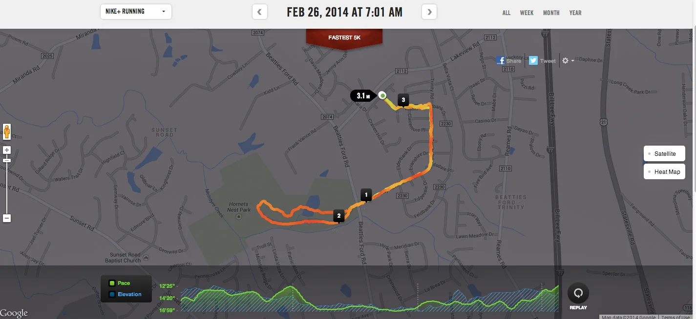
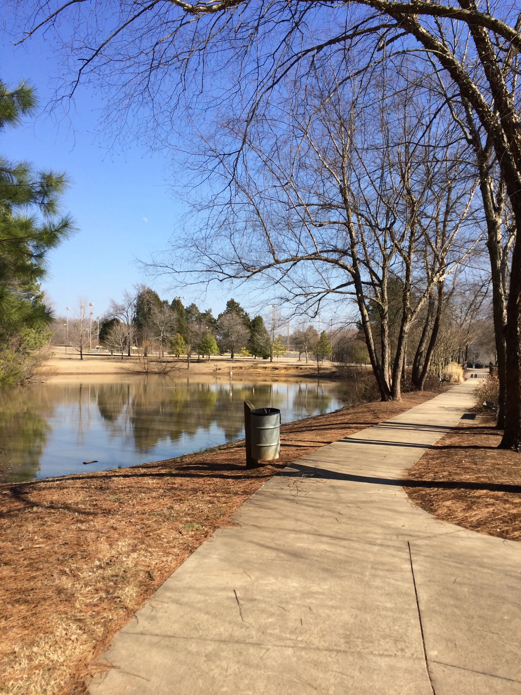
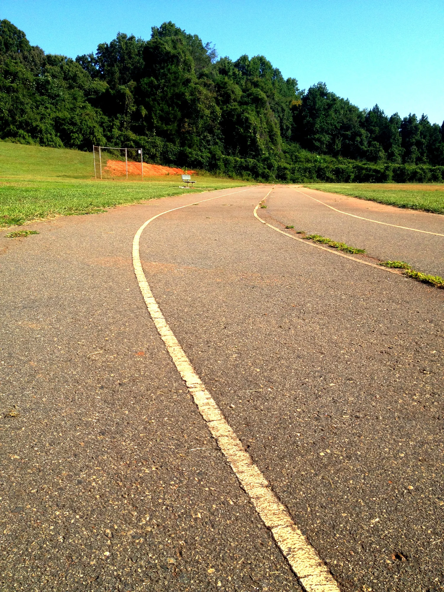
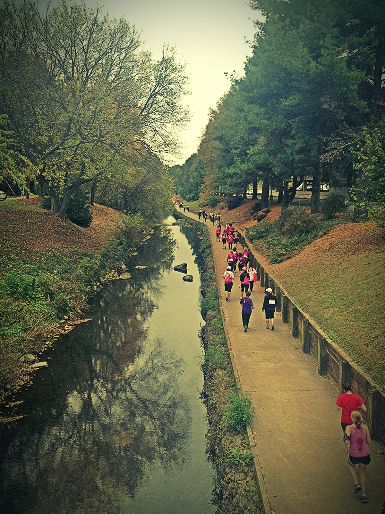
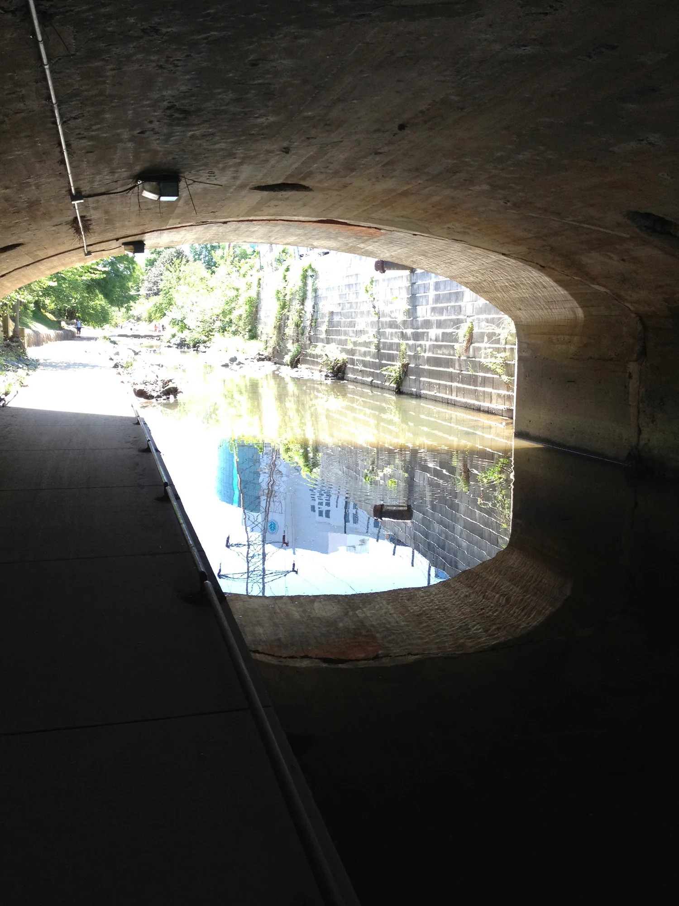
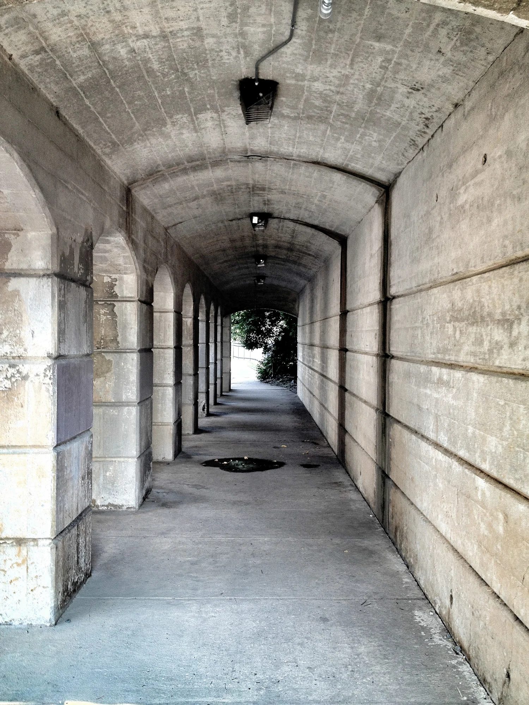
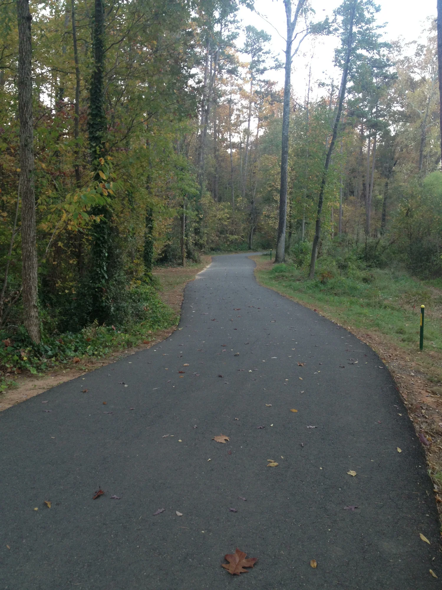
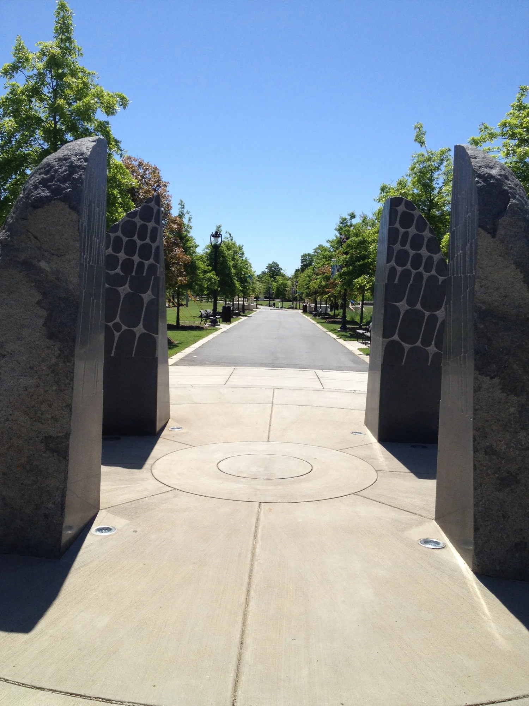

Nike Running

## What I've Learned From Running

## Peace

On the days I run I look forward to the quiet self-reflection it always seems to provide. My preference is to run in the morning, it puts me in a mindzone. The sunrise, music, nature [& her sounds] offer tranquility. There are times when I turn the music down low so that I can hear the birds, wind, trees and water. This sets the tone for the rest of the day; relaxed in love, work and everything else it may bring.

##

## Perseverance

I ran 3.5 miles on Friday and believed I could have run 15.5 more but time and work. This morning I could barely complete one mile before my legs felt like cement. Overcoming the desire to stop running and pushing through the discomfort has more to do with determination than physical stamina.

## Red Earth Mode

I've sourced these social streets for running tips and I've received great advice in addition to a few highly personalized choices. The real take away is that running itself is highly personal. There are millions of running communities, however we are all just one... alone in a crowd. If you polled a million living souls you would find they all do it for their own reason, for me it not only benefits my body but also my head.

I Am
