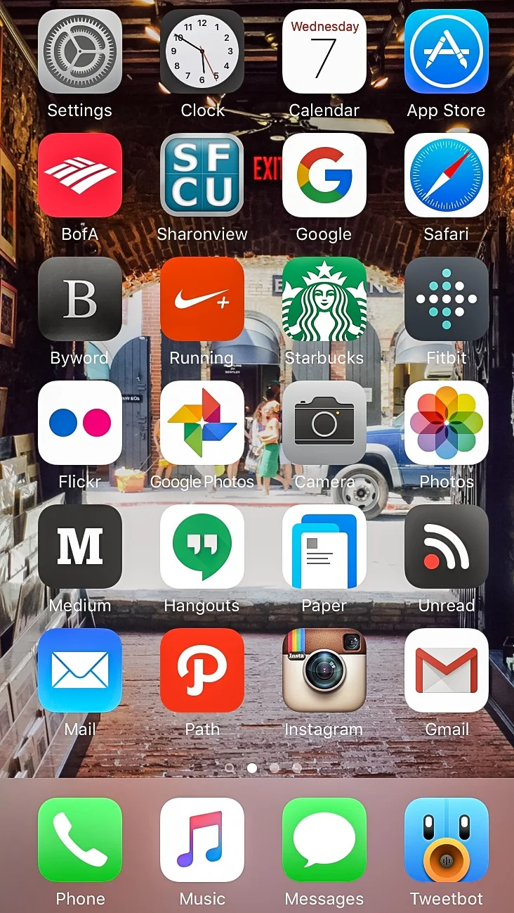
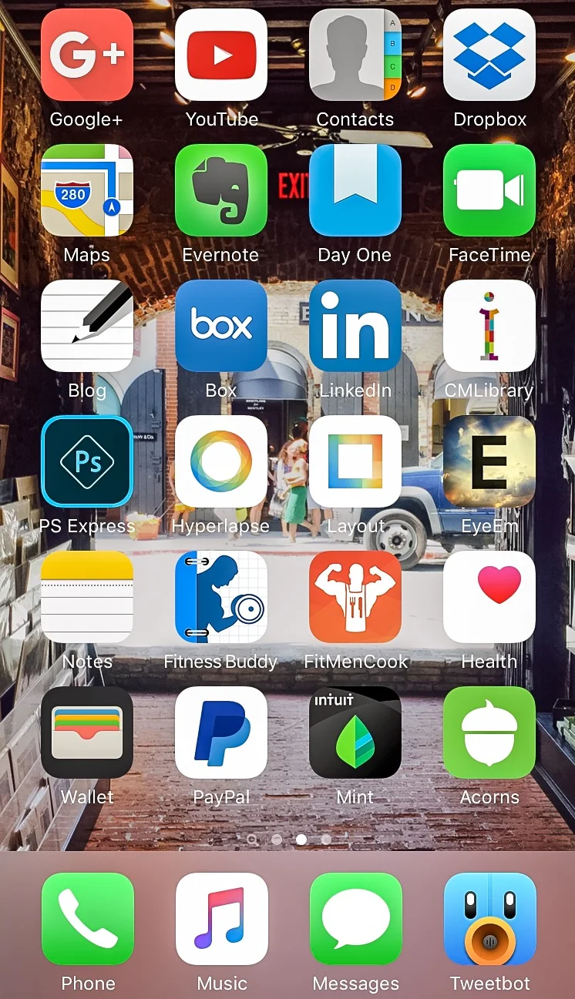
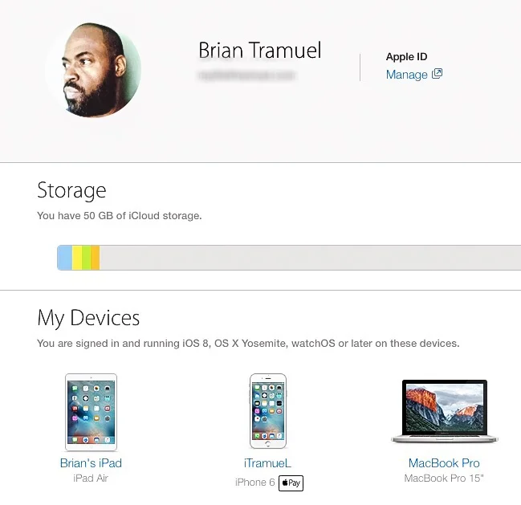

## **With 16GB iPhones**

How awesome is this narcissism; sitting on the couch with my iPhone, iPad Air and MacBook Pro everything in sync. Michelle, who is sitting on the couch with me, seemingly annoyed with the simultaneous notifications. & then my Apple life flashed in front of me, my photos are not syncing to my iPhone.

Long story short, the iPhone is not in harmony because I’ve used most of my available space on photo editing apps, probably. The irony.

As I sat there in the moment, a brief space-time continuum of deleting photo editing apps to make room for my photos to sync, there was this random observation about nothing …

## **You Will Run Out of Space, All of the Spaces**

### **Personal Space**

I’m pretty good with typing and can knock out a few lines of text w/o looking at the keyboard, however at one point I sat on the couch trapped in a glass case of emotion deleting a misspelled word and every time I tried to retype it I felt a sharp twinge in my side causing me to misspell it again. (*Flashback*) I don’t know if you have those automatic towel dispensers in the restrooms on your job but I spend fifteen minutes waiting on it to stop spitting out more towels, I just keep grabbing, and grabbing, and reaching … infinite and then I wake up, sort of like how I did on the couch when I realized what was going on. Michelle was sprawled out on the couch, I was stuck on the edge, holding on for my Apple life and her sharp, narrow feet were poking me in my side.

Same as in the bedroom, only I’m doing the poking. [Kanye West: Heh!]

### **Living Space**

Y’all know me; I Am an introvert, I Am a typical Virgo (nitpicky, exacting, semi-clean freak), I like eating the P and I, not too long ago, was single and living in my own space.

What a time to be alive.

Now I’m here, married and we have the kids and we have the dog. Electric relaxation and It has to do with lots of loving and it ain't nothing nice … and it ain’t nothing nice.

Our next home has to include a man cave.

### **Workspace**

Having been with BAC for a long time I’ve become quite protective about my system for getting things done. Although I’m rather humble in a general life sense, I can be quite particular about my workspace and how I organize. I like to fashion it to the way you feel when you put on a suit, or a dress, fresh from the barber or salon; you hold your head high, walk a little taller, and smell that? It’s pride coming up from deep down inside your loins. That’s the way I want to feel when I walk into work, except we are in an older building with cold, gray prison walls and 1960’s style dentist office carpet. We actually removed storage space to make room for more cubicles. You know what the top priority on employee satisfaction is? Not money, but a new building.

### **Outer Space**

If the sky is the limit, what is outer space?

A growing world population, global warming (anagram: ball going warm) … this will require resourceful housing alternatives. Y'all remember Now & Laters? I preferred grape.

Improve life on Earth with outer space technology now, gentrification later.

I Remain
