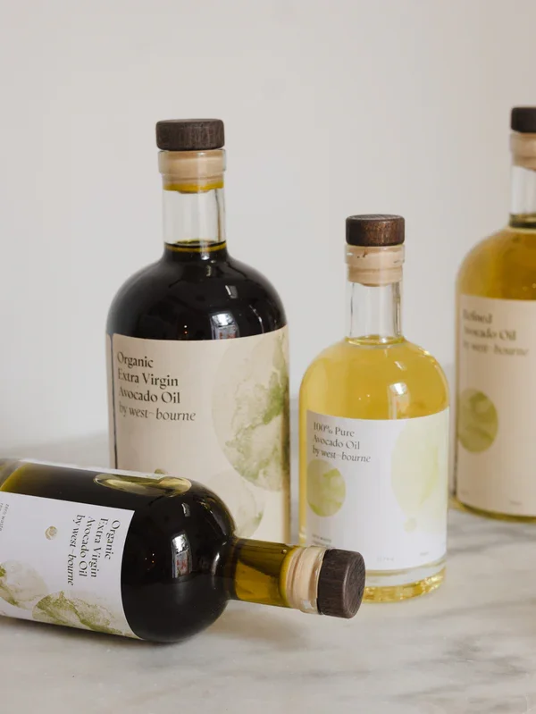

I’m not sure when it happened, but I started splurging on avocado oil. Not just any oil *the* good stuff. The kind that’s smooth, almost creamy, and makes everything taste better. There’s something about opening that bottle, watching the green-gold drip out, and knowing it’s going to make a simple meal feel a little extra. Honestly, it’s one of those little things that feels like a small win, like I’m treating myself without going overboard.

Here’s the funny part though: I’ll drop money on that oil without blinking, but when it comes to other parts of life, the things that matter more than avocado oil, I’ll talk myself out of splurging. Time with people I care about, doing the things that fill me up, even taking a nap without guilt... that’s harder for me to prioritize sometimes. Maybe it’s all about the small acts of rebellion, though. Like, splurging on good oil is my way of saying, "I’m not going to skimp on things that matter," even if they’re simple. Funny how something as small as oil can remind you to pay attention to what really makes life richer.
