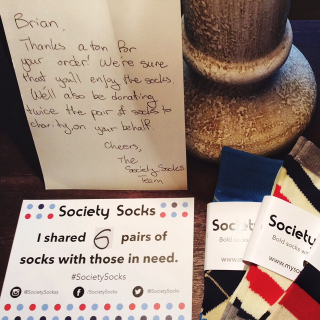

Last month I started writing a series titled [A Richer Understanding](http://retirementsavvy.net/a-richer-understanding-physical-and-fiscal-fitness/) on [Retirement Savvy](http://retirementsavvy.net). When I was single, I only had to be responsible for*my* money and *my*spending. Now that I Am married I’ve adjusted my thinking to managing money jointly. The theme of the series is a non technical view of how we relate to money and by “we” I mean; family, friends, co-workers and you. My awareness is heightened because of (not in spite of) the writing and perhaps an understanding of my attitude towards money.

It hasn’t been hard finding topics. As I write this, a friend is texting me about the Department of Justice settlement where she was awarded a home loan modification with a very low fixed interest rate and a portion of her principal forgiven. Our daily lives are sprinkled with conversations about income, spending, and debt. To quote the prolific poets of the Wu Tang Clan “Cash Rules Everything Around Me, C.R.E.A.M. get the money, dollar, dollar, bill y’all.”

I Am also a reader of Retirement Savvy, great topics and thought provoking posts abound. Talking about money can be intimidating, especially when you feel that you’re not making enough, you’re not saving enough, you’re not investing in your future (retirement) or have too much debt. Most don’t understand that they are already engaged; $200 dates, fly outs and traveling. Twitter conversations count or nah? Seriously, those are money conversations; folks just aren’t expanding upon them. My timeline is filled with folks that love to travel, all that is missing from the conversation is how they prepare, plan and save for it.

My kids recently tested my gangsta’, a package with my name on it arrived at the house. I imagine they waited all day to see what was inside; with all eyes on me they watched in wondrous amazement as I opened it. The look on their face was priceless once they realized it contained socks. They said: “You’ve spent a lot of money on socks.” I said: Yo’ mama. No, I really said “Also on food, clothing, shelter, summer camp, North Carolina Dance Theatre, basketball camp …”

It did spark a thought about discretionary spending and whether or not I Am as diligent as I should be. The Future is Now and I have a spending plan that we’re still tweaking, and although (I believe) we have accounted for everything, one (sometimes both) of us may end up with a surplus at the end of the month. I’m good about throwing my extra into a savings account or putting it into Acorns and less frequently I may use it to faux ball out on what I consider non guilty pleasures.

**Socks**,

Supporting a social cause with [Society Socks](http://mysocietysocks.com)

**#DateNight,**

Supporting my marriage

**Pedicure / MANicure,**

Supporting small business; (Sheena, double minority; black and female) [AlphaMale Nail Care](http://www.alphamalenailcare.com)

> [A video posted by AlphaMale Nail Care Services (@alphamalenailcareclt)](https://instagram.com/p/r15-vIRVVQ/) on Aug 18, 2014 at 7:03am PDT

For the sake of making a living, at times, we forget to live. Find a healthy balance.

I Am
