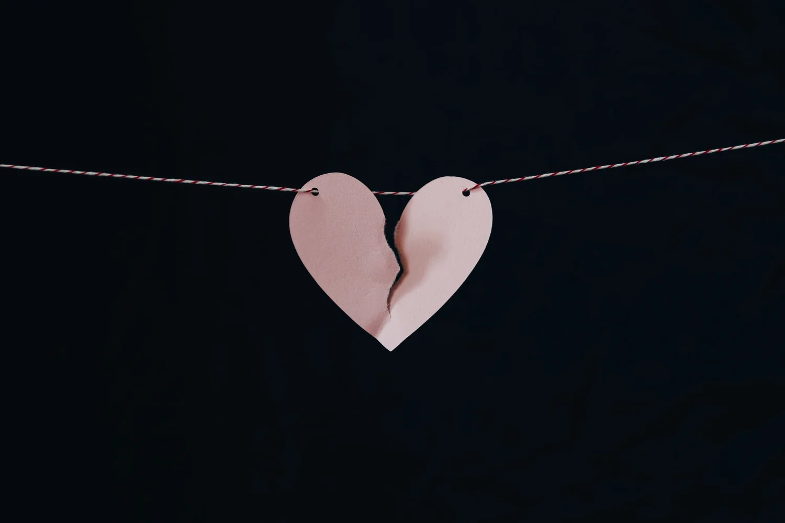

# Natural Sympathies

Michelle uses a handyman around the daycare(s) to do detail cleaning, painting and other ‘handy man’ jobs. This resource carries over into our personal lives; helping around the house(s) — ours, my mother in law and sister in law.

My mother in law has a sizable Koi pond in her back yard filled with fish. The handyman cleaned it on Friday but did not re-attach the pump correctly, sadly the fish did not survive.

My mother in law *had* a sizable Koi pond in her back yard filled with fish. No thanks to the *not so* handyman.
