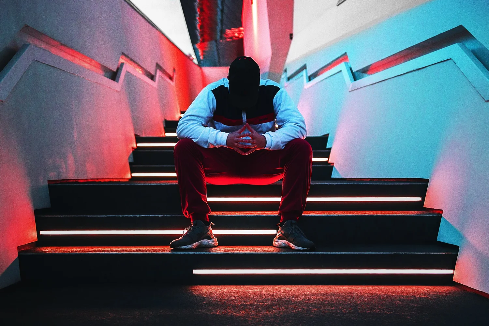

# First Choice

What started as a joke with my homie worker friend last week ended up as a vow to create a poll to see if women and men are with their first choice or if they've settled.

It started with random observations about nothing, yet everything concerning a few odd couple pairings, note I am using too me language -- The couples are in different stages of their relationships although most are planning weddings, recently married or have been dating for a long time.

I never observe a loving, happy moment. Someone is always barking orders at the other or voicing a complaint. Wedding planning, new house purchases, new car purchases, and family planning -- should all be happy right?

### Right?

Although I am not with them one hundred percent of the time, it seems to me that in person they would put on the same front they put on social… never mind.

Makes me wonder if they’re with their first choice.

Lol, I’m just serious.
