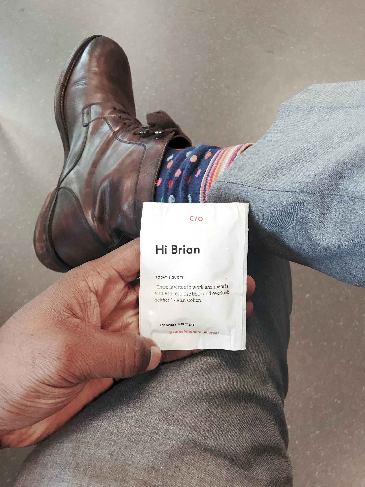
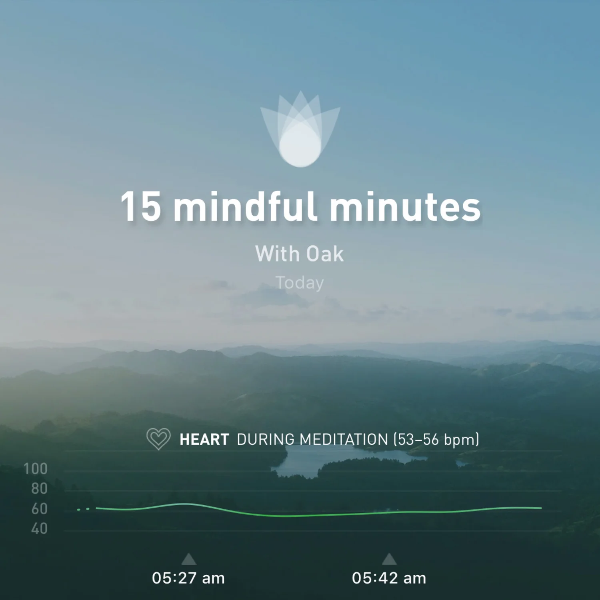
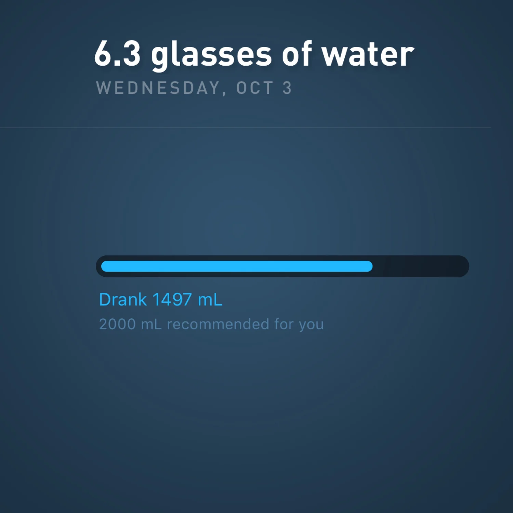
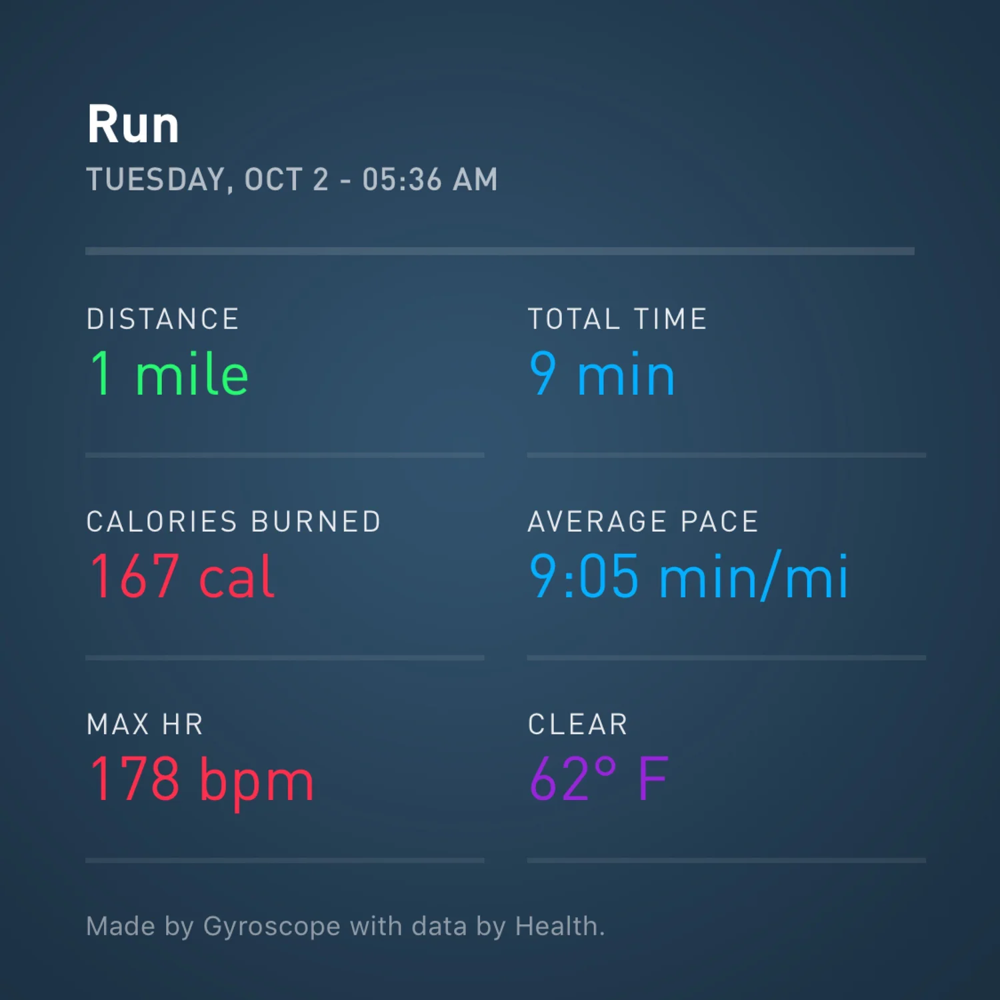
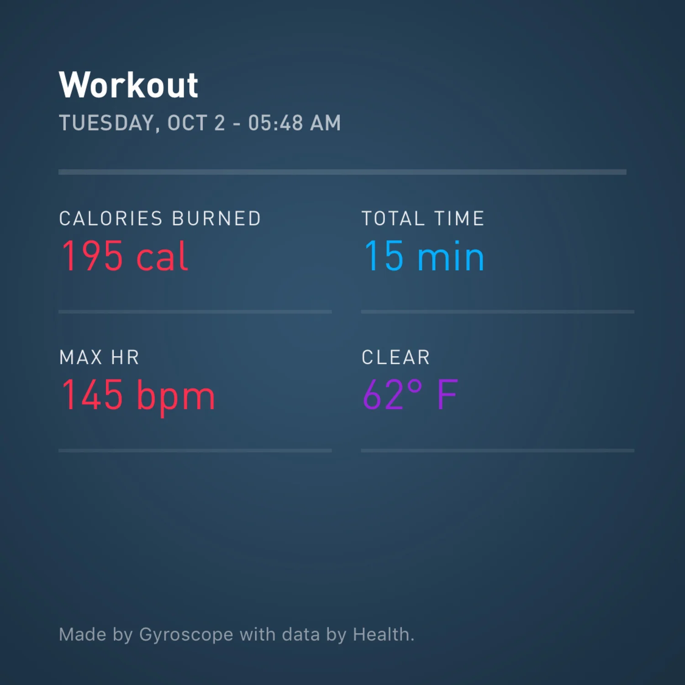
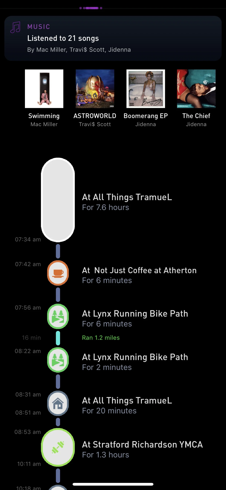
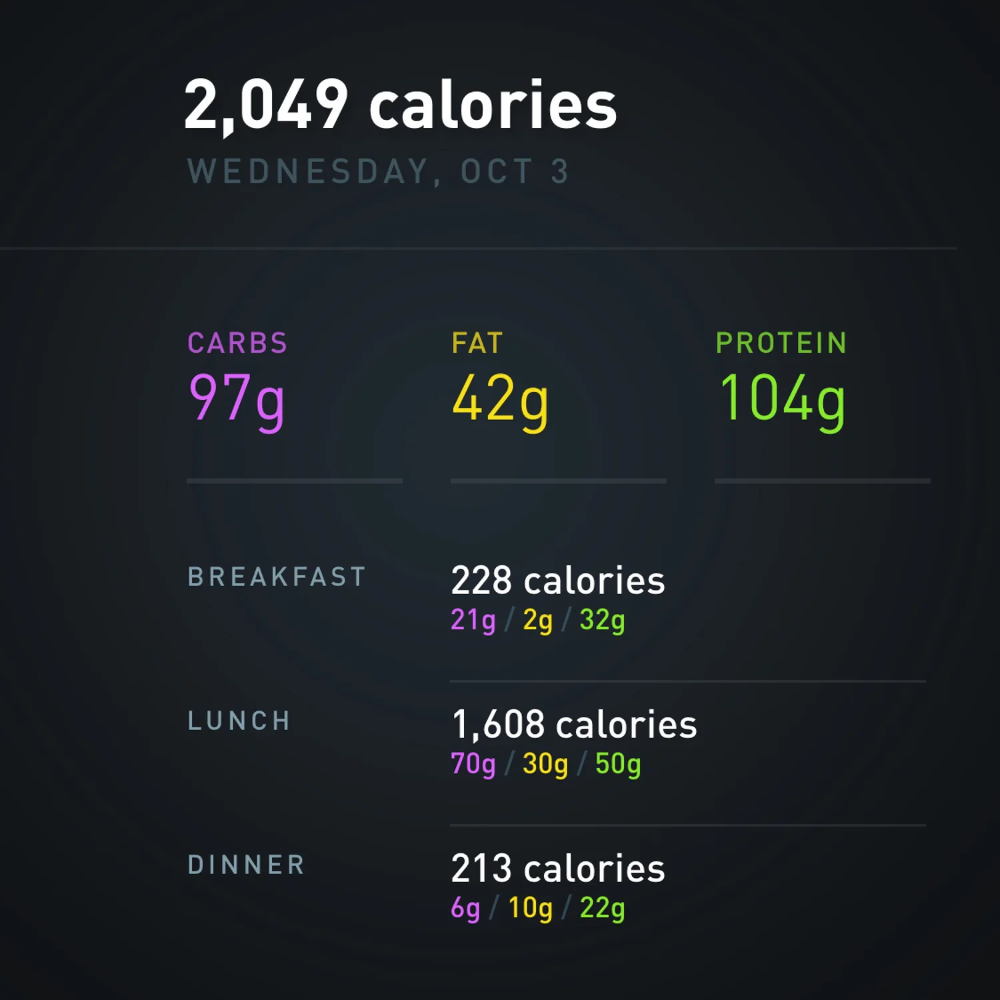

# Society Socks

During the week the toughest decision I face in the morning is what socks to wear.

I wake up without an alarm clock, meditate, drink water, take my vitamins and head to the YMCA without missing a beat. Returning home to fix a protein shake, pack lunch, shower and get dressed.

While I have managed to fit all of the above in a two-hour window the thing that throws me off of schedule is deciding on socks.

Lol, I'm just serious.

There are many simple things that bring me pure joy. The sound of silence. The sound of my iPhone’s camera snapping. Reading a good book. Music. & New socks, I love them — funny thing is I might own a million-trillion pairs but have an eight to ten pair rotation.
