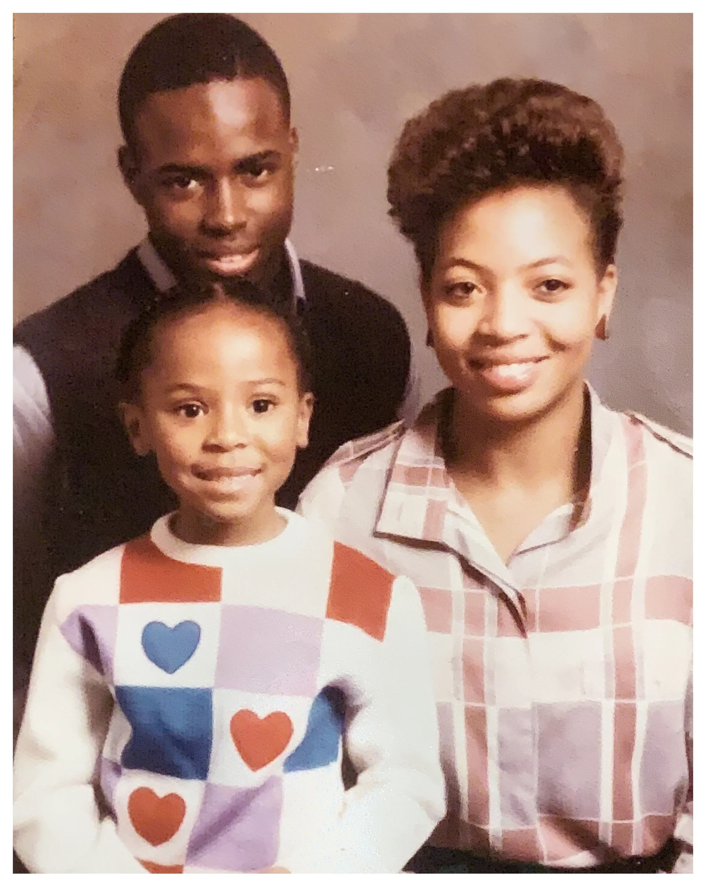

# Happy Birthday!

Tomorrow is my first sister's birthday (writing older sister sounds rude ;) and as I am going through my contretemps with Geneva I’m reminded of how I treated my folks at the same age. In retrospect I believed everyone was responsible for my shortcomings, I was selfish and self-centered.

My sister was living in Atlanta with her (then boyfriend) now husband (of twenty-two years) -- She saw that I was headed down a path to an unfulfilled life and moved me down to live with her. This is doubly dynamic (1) because it put a strain on her relationship, and she had to move us into our own place that I barely contributed to. (2) I was unemployed.

A childhood friend of my brother in law was a chef at Morrison's Cafeteria and set me up with a job washing pots and pans.

### My God.

It lasted for a while but I believed I was greater than it.

Long story short, I had ups and downs but eventually got myself together -- with respect to work and being responsible; however the selfishness continued for years. To that point, I have never been without a job and during periods of underemployment I would work two.

My sister saved me from living and unfulfilled life.

Happy Birthday Dear Libra,

First sister, second sister & me in the middle of it all.
