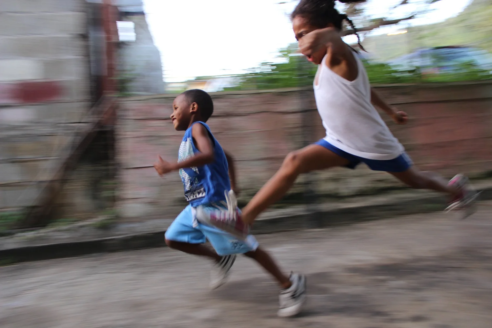

# Five Things I Learned From Being a Kid

## Be More Childlike and Less Childish

Young children are often impulsive, pouty, and have outbursts of anger. If you don't have kids, listen to me now and believe me later. Behaviorally, they are prone to lying, blame others to avoid responsibility, are predisposed to bullying, and often need to be the center of attention. Reading that back to myself it could also be used to describe any place of employment. Don’t @ me.

Adults are playful, creative, unselfish, and teachable.

## Model Friendship

Although we have hi-jacked the word friend, our childhood offers a model of what our friendships should be. Love, honesty, closeness, and accompaniment. According to C. S. Lewis, there are four human loves; affection, Eros, charity, and friendship.

Adults need genuine friendships.

## Maintain Individuality

At times we go against what is popular to make a statement or use covering to hide what we love. Selfishness can be healthy too, be yourself.

Adults don’t need to explain their choices or beliefs.

## Escaping Reality

As a child, I would play for hours with Star Wars action figures. I've learned to turn that creative play into non-guilty pleasures.

Adults need an escape from reality every now and again.

## Facing Reality

Escaping can be pleasant but often unproductive. Face the truth. When there's a situation that's uncomfortable, young children might escape reality to stay out of trouble but…

Adults deal with reality.
