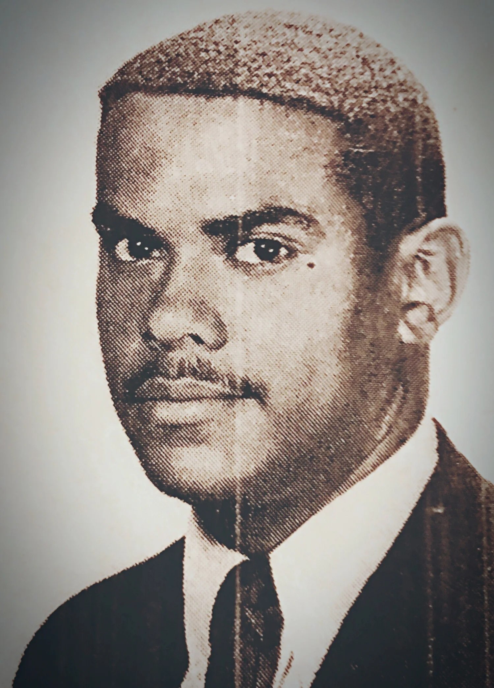

Although he is not my [biological dad](https://www.tramuel.com/iam/2009/12/29/sperm-donor/), he is the only father I’ve known since the age of five. He stepped-in, so I took the step out ...

# **Of Being My Dad**

He has good taste, has an affectionate nature.

He is [good-hearted](https://www.tramuel.com/iam/vibes-stuff/), generous and has good character.

He likes well-being, comfort and a life without problems.

He is easy to approach and has good relations with his circle.

The most impressive part *of being my dad* is strength of character during difficult times. At times this has enabled me to ennoble my own mind.

I remain.
