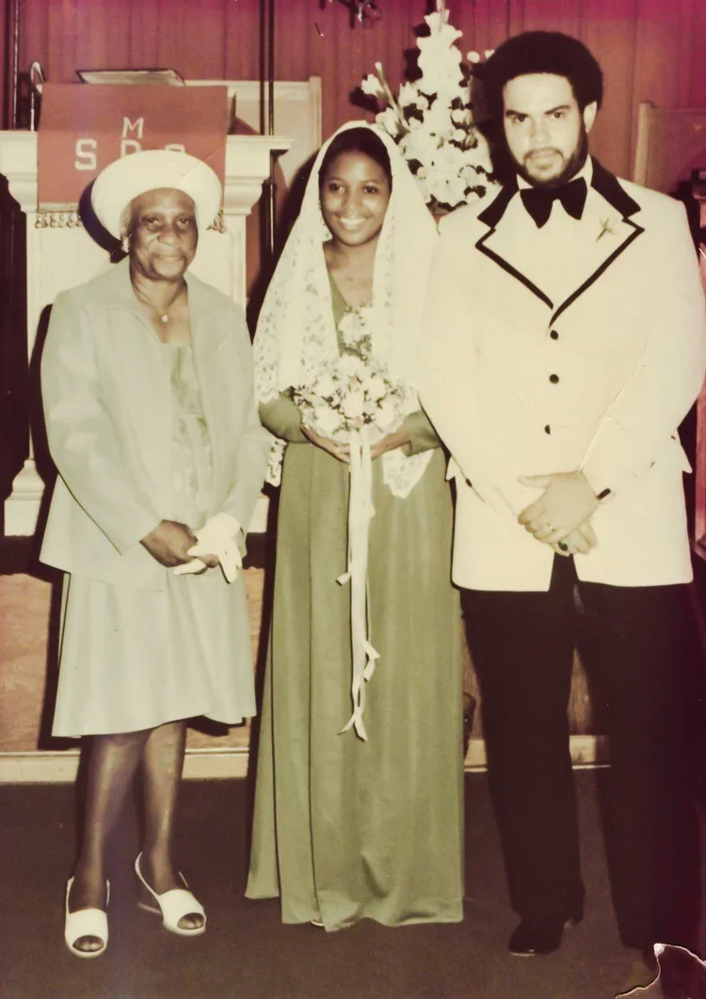

My mother has a great influence on our family, immediate and extended…

*She sees possibilities and potential.*

*She considers carefully words, actions, and relationships between people and things.*

*She discusses emotional meanings of words, ideas, needs and problems.*

*She enlarges plans, ideas, and proposals*.

Currently, one important aspect ***Of Being My Mom*** is on display…

### **Emotional intelligence**

Emotionally intelligent people won’t dwell on problems. Where we focus our attention determines our emotional state and with everything happening to my mother she chooses to focus on thought processes and actions to better her condition.

This has created a sense of personal efficacy that’s produced positive emotions for us all. I’ve observed her condition go from...

"There is nothing we can do."

fast forward one month later, to an image of her sitting on the couch, watching television at home.

If you want to know where the [men in my family pull up their strength](http://tramuel.com/iam/of-being-my-dad), look at the women.

I Remain.

