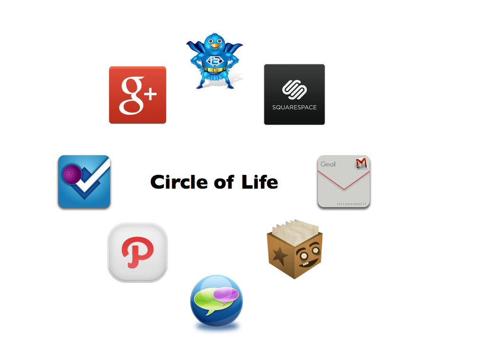

I'm able to write this post for two reasons; I bought a new battery for my computer, now I can go the whole day [pause] and free wi-fi at this laundromat. The dryer needs to be replaced at home so I'm here because The Future used the power of the P.

We all know I'll do anything for pizza.

**Destroy and Rebuild**

The main reason I *destroyed* my original twitter was so I could *rebuild* it into a more interactive stream. Although it took time to build a high follow / follower count, I didn't have many interactions with those outside of the circle of blogger[s] whose sites I frequently commented on and shared with. Side note: I dislike referring to folks as followers, a little too Jim Jones for me. [People's Temple not The Diplomats]

My new to me account has less than two hundred connections with triple the interactions. Some funny, some smart, some political, some spiritual and some about nothing. Constantly learning from my connections, Twitter has become the equivalent of that go-to friend that doesn't know everything but is knowledgable about most things.

My mantra of sorts has been *striving to create balance and harmony; spirituality, mentally, emotionally, physically and financially.* Those with whom I interact the most within these social media streets represent every part of that.

Truly an extended family of brothers, sisters, cousins, aunts and uncles. All of us trying to navigate this informal milieu to find or do [insert your truth here]

This post while random and about nothing is everything. Keep up.

I Am
