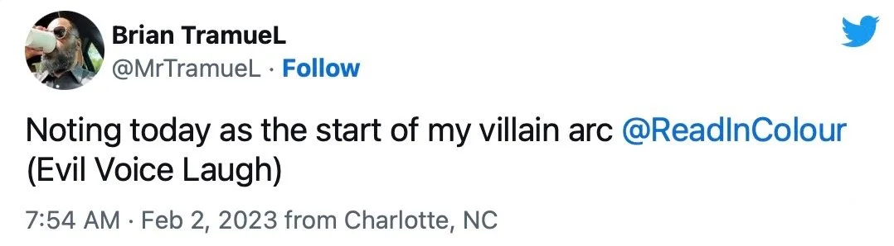
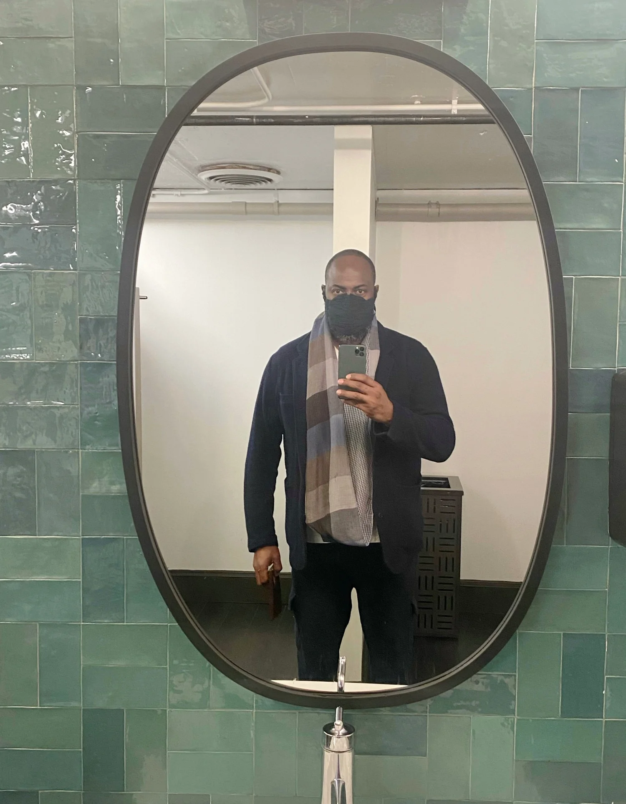

Often we hear living souls state that they “have entered their villain arc” or have “become the villain” in the context of their social systems. I Am using to me language, I believe it means that they are setting boundaries or moving away from unhealthy relationships.

There are instances where the villain has a better philosophy than the hero he is rutted against.  With respect to matters of the heart, I believe I’ve done everything from wearing a mask to being wide open.

Neither worked.

Now I’m going to be bad, but with honesty. Not to be confused with “I’m going to be bad, honestly.”  I will state my intentions up front and I imagine ten out of eleven rejections…

Options may be low, but they’re never zero.

Respectfully,

The Villain

Mr. Ataraxia
