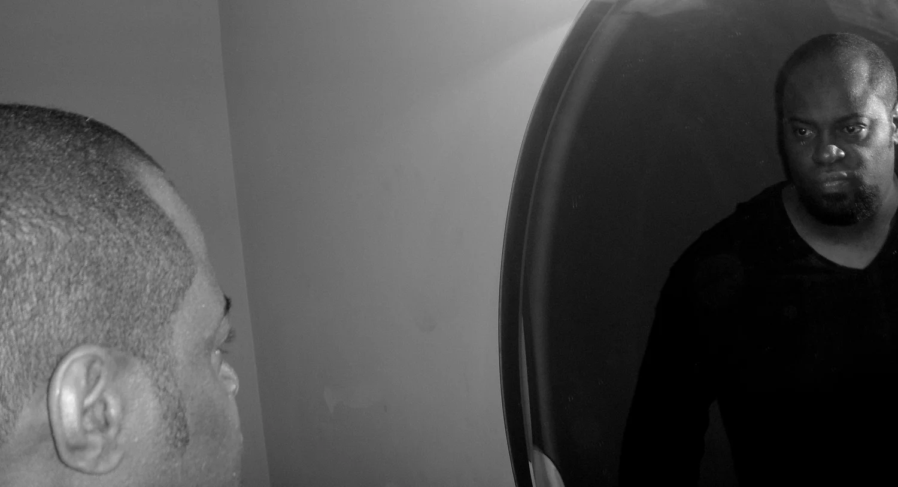
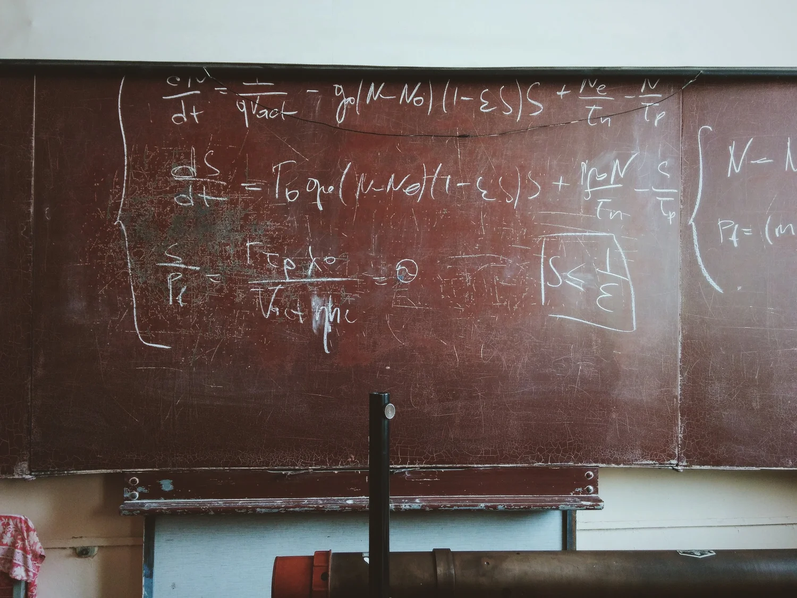

I’ve been reminded a few times this week personally, professionally and socially that with the passage of time we tend to hold onto images and thoughts from the past. Similar to the way I look in the mirror (now) at age 46 but somehow see my 26 year old self.

**#StillFineTho**  
  
There were a few things that happened to me that led me to consider: What if we left the past in the past, and relieved ourselves of injustice collecting? Injustice collecting is when we call up different ways to feel cheated, victimized or otherwise offended.  
  
There has been no greater example of this for me as I look ahead to my 30 year high-school reunion.  
  
I was excited to receive notice and an invite to our class FB page for updates and planning. I did not attend any of the previous reunions, primarily due to negative self-talk and ‘injustice collecting.’ I hear one of two responses when I Am reunited with others from (high) school, most of whom I haven’t seen in over 15 years (1) I had the biggest crush on you and (2) You were stuck up. I know now without any reservation that I Am an introvert. I believe in high-school this perception of me as stuck up was because of, not in spite of my introversion.  
  
**#IGotaBIGEgo**  
  
Most of us couldn’t spell introversion in the 80’s (probably) much less recognize it. So naturally, they acted like they ain’t know me, now that I’m *#StillFIneTho* they all on me.  
  
Lol, I’m just serious.

Add the one, carry the two. Spelling

I was reserved without close friends and placed more value on one on one connections within a small circle of friends. That circle of friends sustained (each of us) from grade school through high school.  
  
**Northwest stand up.**

Photo by [bill wegener](https://unsplash.com/photos/LqOO5Ko0zSo?utm_source=unsplash&utm_medium=referral&utm_content=creditCopyText) on [Unsplash](https://unsplash.com/?utm_source=unsplash&utm_medium=referral&utm_content=creditCopyText)

I believe at times *we* can be emotionally intelligent to the point that we forgive but we never forget. I suppose that is a trigger to prevent us from future harm. The problem for most of us is the thin line between preventing future harm and holding onto the slightest misdemeanors from the past.  
  
“Too cliquish, stuck up, smokers, jocks, nerds, etc.,” all the labels that divided us then, should not be the image we hold in our heads now. We are whole grown ass adults and whatever frustration or regrets from our past ain’t happening right now. When you live in the past, your past becomes your present preventing you paying attention to right now.  
  
We should take the time to appreciate the moment right in front of us.  
  
*No matter what a wo/man’s past might have been, their future is spotless.*
