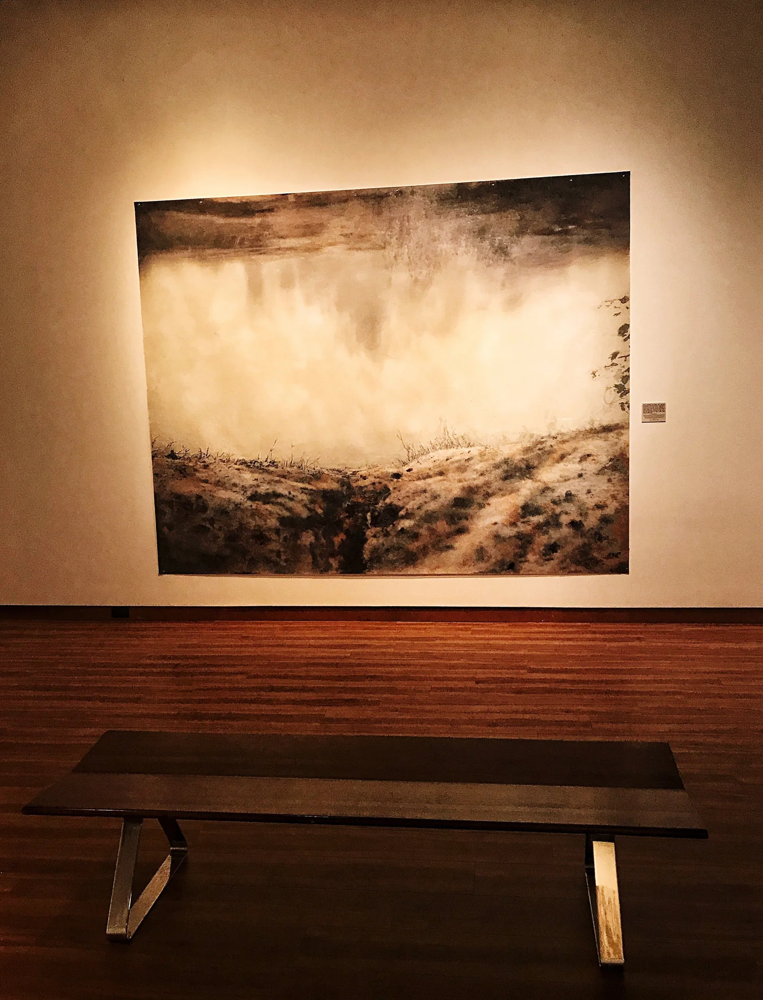

Mixed-media on canvas, black silicon carbide, industrial ink, gel medium, neutral pH adhesive,  
natural dyes and extracts, variant mordents, and marking beads

- [Harold Mendez](http://haroldmendez.com)
