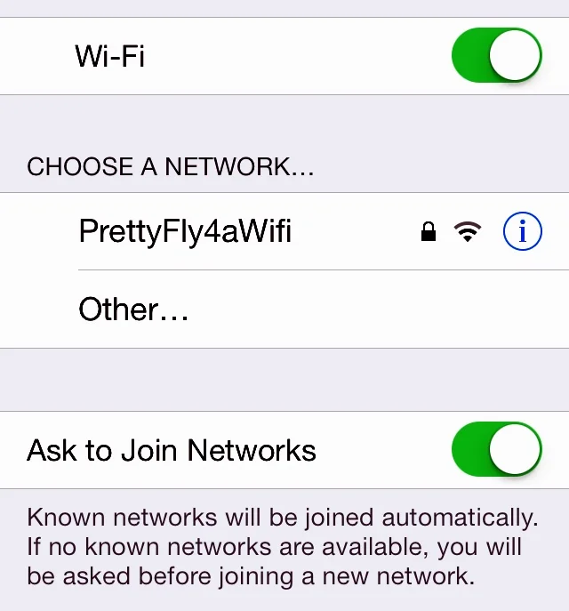

Last year I was pretty upset with the customer service I received from Verizon Wireless and threatened to cancel my service, well they took my threat literally and did it for me. I couldn't even be mad, I was pretty vocal about my disapproval. This led to a three month period between carriers, my intent was to reopen the account with Verizon but made an interesting discovery while I was without service.

## Self Imposed Cell Phone Respite

While that is not entirely accurate, I did however find that how Iused my cell I could essentially make it with only a wi-fi enabled device.

### [♫](https://db.tt/3B9ZCmVn) They don't talk no more, they don't talk no more, all they do is this...

### Data.

With the advantage of mobility, flexibility, convenience, and low cost, wireless technologies have been widely used around us to replace the traditional wired networks. Whether we are in the neighborhood park, a restaurant or airport we won't miss an opportunity to post to Facebook, Tweet, Instagram, FourSquare, eMail, Text, Mobile Banking, Fitness, Blogging… Infinite.

Various standards have been developed to fit different application requirements and we have the ability to send free text messages, make video & voice calls all over wi-fi. I did all three seamlessly with the [Google] Hangout, WhatsApp and FaceTime app(s) during my respite.

### [♫](https://db.tt/vpDlSGv1) Telephone Love

Telephone love, you sound so sweet on the line  
Telephone love, you make my day every time  
Telephone love, you sound so sweet on the line  
Telephone love, you make my day every time,

Every time.

Between work and home I have access to a telephone. We've focused on cutting the cable; kept Time Warner Cable basic service at $17 / month [channels 1-24] purchased two Apple TV(s) and one Chromecast [not thrilled with this device but thats another post] we are able to view our Hulu Plus and Netflix subscriptions from all of our devices and TVs, all in all we've cut $180 per month from our expenses. The savings could have been greater but we upgraded the internet connection, I believe this is important as it gives us better access to the TWC Hotspots throughout the city, add that we have a million devices connected to wi-fi in our home and I like to go really fast, zero to a hundred real quick.

Is it premature to start a discussion about cutting the mobile contract?

Stay woke, [Net Neutrality](http://www.fcc.gov/openinternet) … [Google Fiber.](https://fiber.google.com/about2/)

I Am
