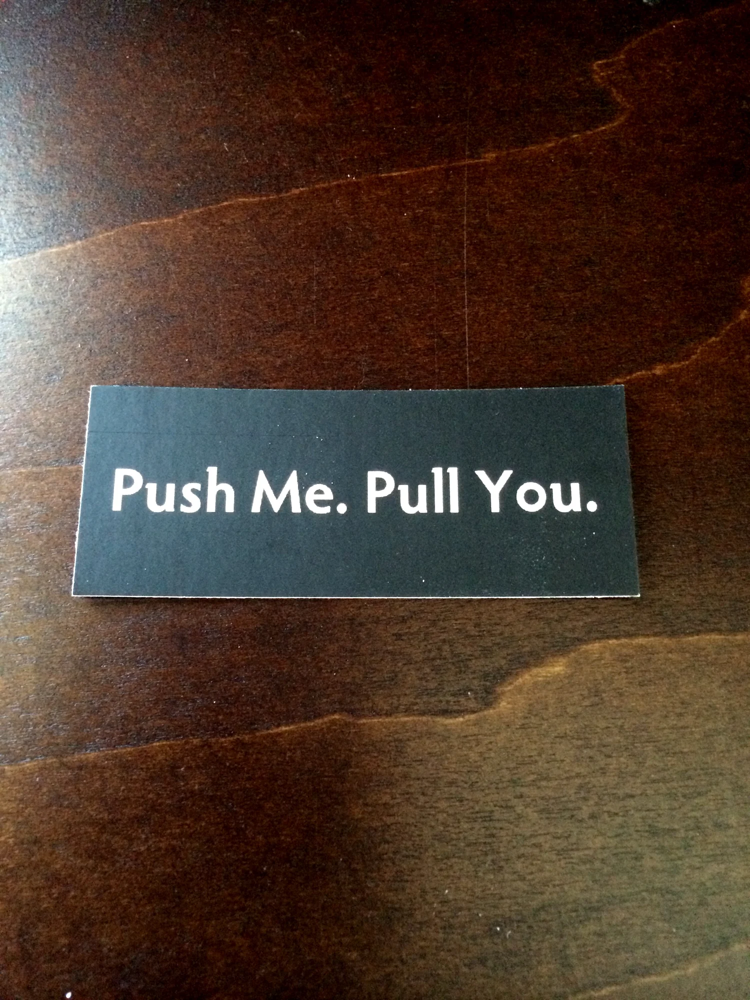
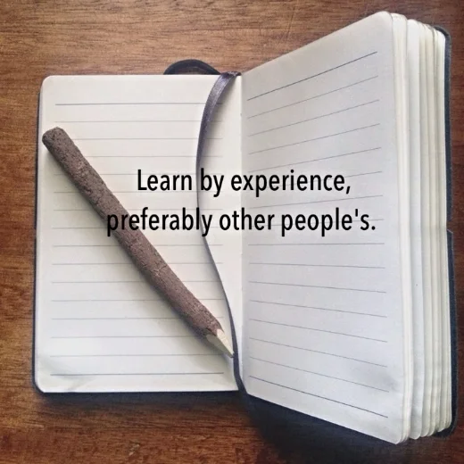

## Sidetime hustle.

In completing my work I'm always in awe of the inspiration others provide to/ for themselves. Vision boards, sticky notes, a screensaver, refrigerator magnets, pictures,

... **infinite.**

## Below are a few that I've taken note of.

*Find out what you love to do and you will never have to work another day in your life.*

*Motivation is when your dreams out on work clothes.*

*Honor is better than honors.*

*Character is what you are in the dark.*

*If you tell the truth, you don't have to remember anything.*

*Big people monopolize the listening. Small people monopolize the talking.*

*Measure wealth not by the things you have, but by the things you have for which you would not take money.*

*Until you make peace with who you are, you'll never be content with what you have.*

*Don't believe everything you think.*

### What pushes, pulls you?

I Am
