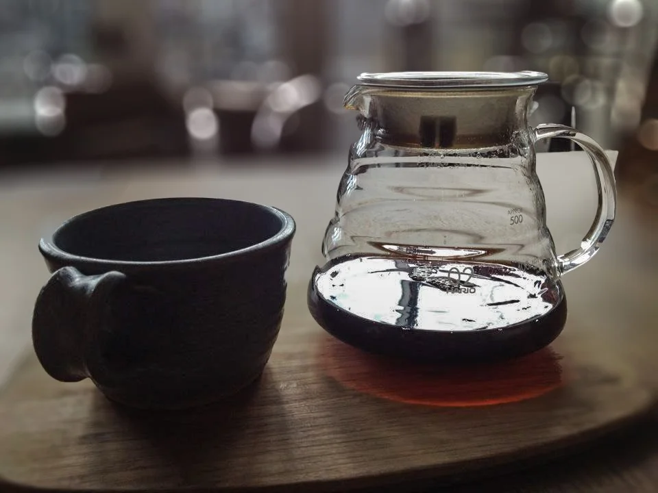

**Free Coffee**

Living souls love genuine and sincere compliments. It makes us feel good, loved and respected. Yesterday while standing in line to pay for gas, I observed a man pay for a woman’s coffee. He simply handed her a five dollar bill and boldly stated “Here, I’m going to buy your coffee.”  The why was unnecessary, she was #Fly.

*I’m sure she knew she was on.*

Meanwhile, I’m standing there putting together an uncommon combination of a one dollar bill, random assortment of quarters, dimes and nickels to put $4.00 in the miracle whip which was on  [e]mpty. My wallet was safe at home.

*I’m sure I was off.*

We’ve talked about compliments and statements of flattery before. To clarify, I do not believe that flattery is the same as a compliment; the end game is different.  I observed both; “You’re looking good this morning” stated with the expectation of her time and /or attention and “Here, I’m going to buy your coffee” stated with no expectations, simply admiration with humility. I’m sure the latter made her feel special.

A gentleman is a gentle man.

