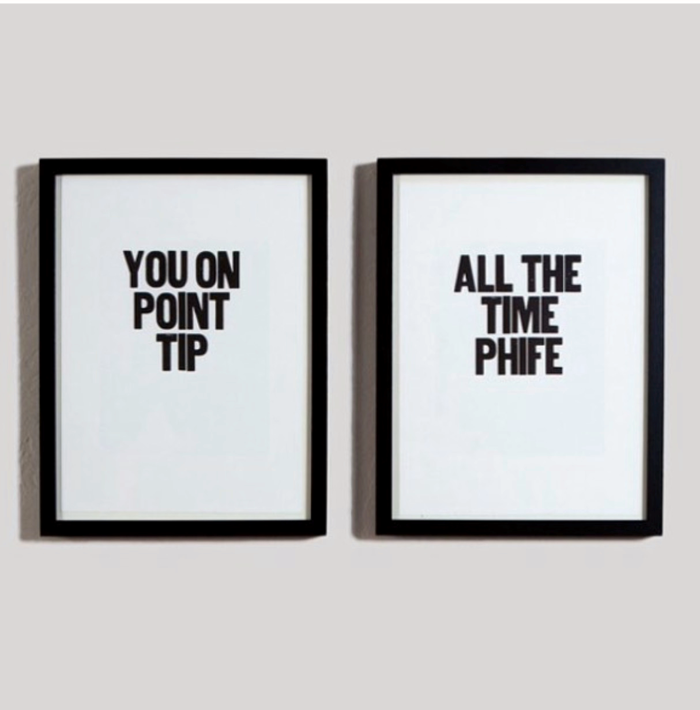

### Random Observation(s) #2916 - #2919

I have an affinity with darker skin women however I have only ever dated one, the rest have been caramel or butterscotch. *Golden brown peach cobbler, Miss african-american pie, Lord I should've tasted, When she offered me a try...*

I enjoy cheese toast to the point of obsession. Mild cheddar off the block on bakery fresh sour dough or english toasting bread.

Least used feature on my smartphone, the phone. People don't talk no more, all they do is this, all they do is this.

I've been q-tip free since '93 but I found a pack lying around this week (probably a takeaway from a recent hotel stay) and with joy stuck them in my ears moving from room to room, that was until I brushed up against the doorway and jammed one further into my ear.

I hate q-tips.

Rest, Malik Izaak Taylor.
