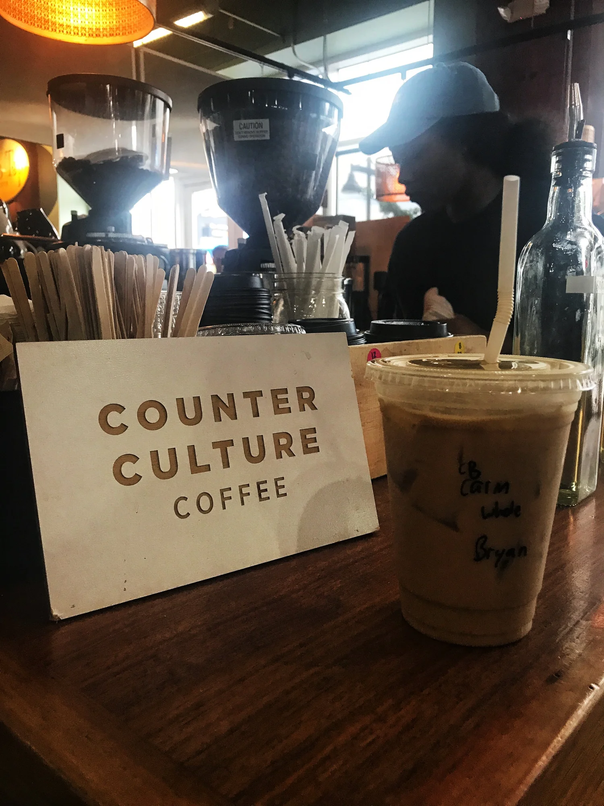
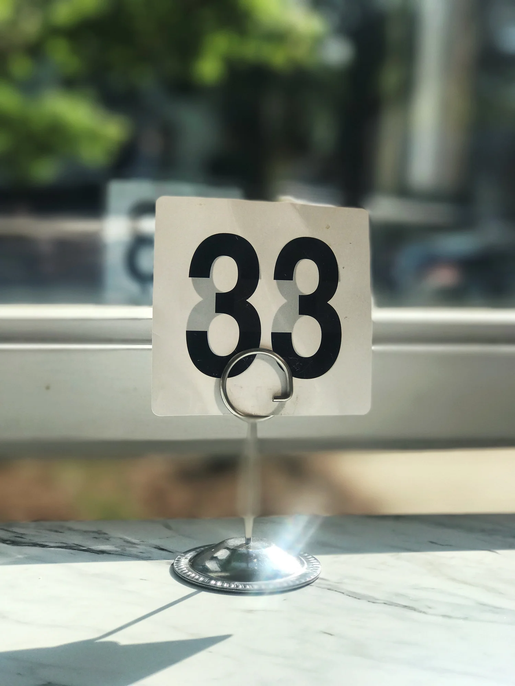
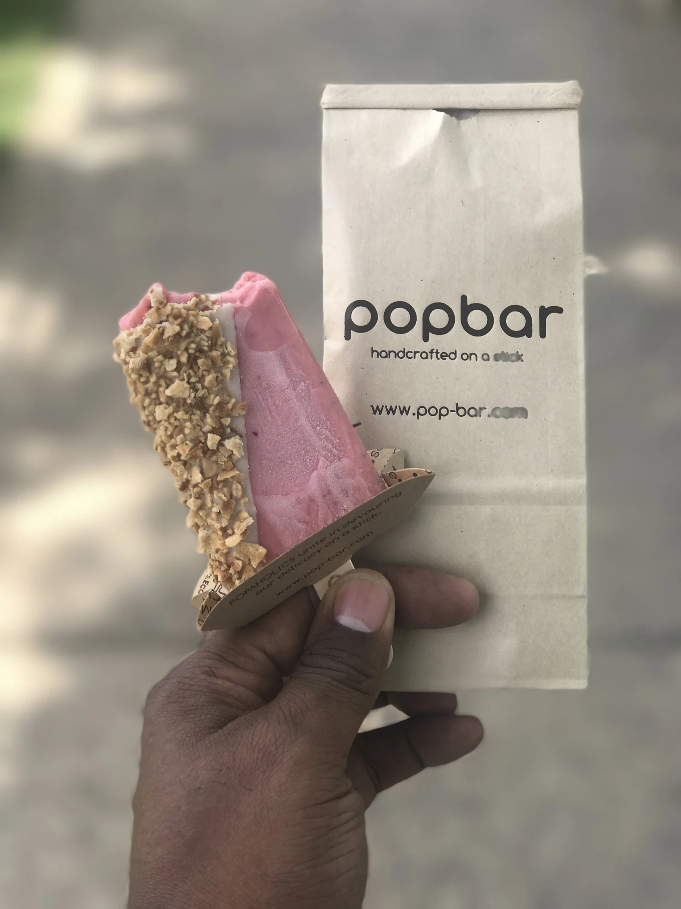

As I sit to write this I realize that I enjoy coffee, baked goods and ice cream way too much, however thats another blog post.

Keep up.

### *I know what they say about me, what they say about you?*

I've developed a mental concentration and awareness that has helped with patience standing on line at any one of the above. A gift and an opportunity I suppose 'cause while I'm patient, aware and focused I'm usually distracted by chaos. Without fail two things always happen to me in line (1) the world record holders for loud ass loud talking are always behind me and (2) their chaos (loud ass loud talking, screaming, over the top laughter or incredibly loud cell phone calls) have to occur as close to me as possible.

Cool, if this happened once.

I could live with it.

But. Every. Single. Time. I visit any coffee house, bakery or creamery?

Not cool, I cannot live with it.

This chip on my shoulder is growing bolder, catching on the flimsiest grievances.

Please keep your public chaos to yourself.

Harm None,

B
