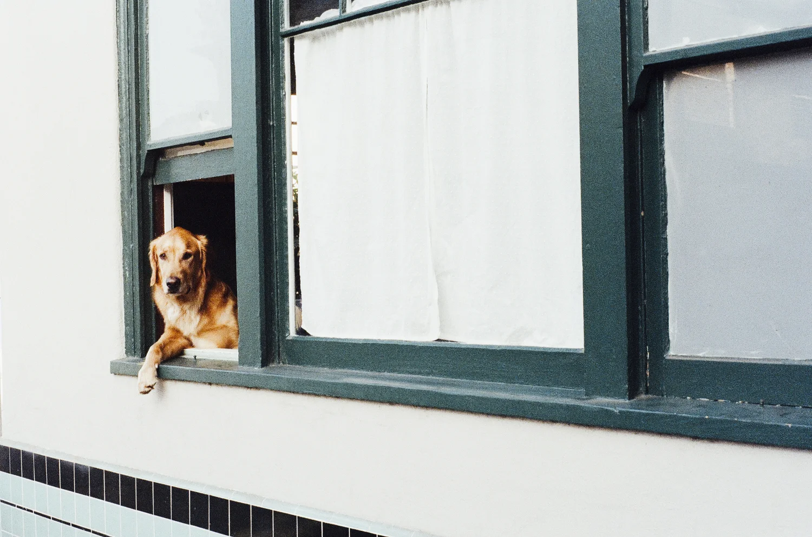

## **Unsociable Behavior**

While on our morning walk, Maestro our 2 year old Cocker Spaniel, rarely barks. The dogs in our neighborhood are either behind fences or kept indoors. There is one however that is on a chain and the owner(s) normally leave him unattended in the front yard. He is pretty agressive to passerbys; canines and people alike.

When a dog threatens, it's imprudent to assume the dog would not carry through on the threat. So we are always on guard, typically crossing the street to avoid any confrontation. The other morning the neighbor's dog had adapted some ancient secret camouflage and appeared to be absent form his normal spot.  Maestro and I continued on our path and as we passed the dog lunged out at us, growling and barking.

Maestro remains cool, no barking back. I did notice his raised hackles but rather than meaning afraid I believe he was more angry that his walk was disturb.

#CanineCool
