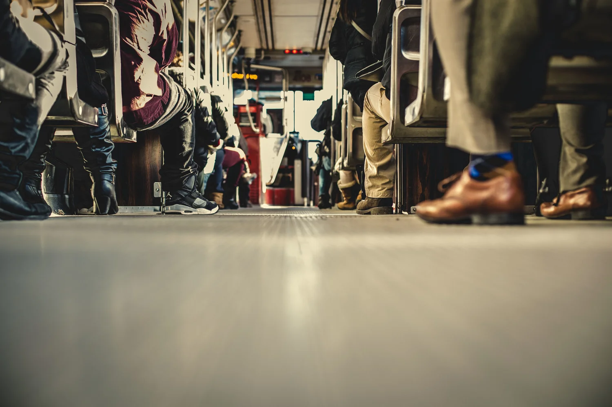
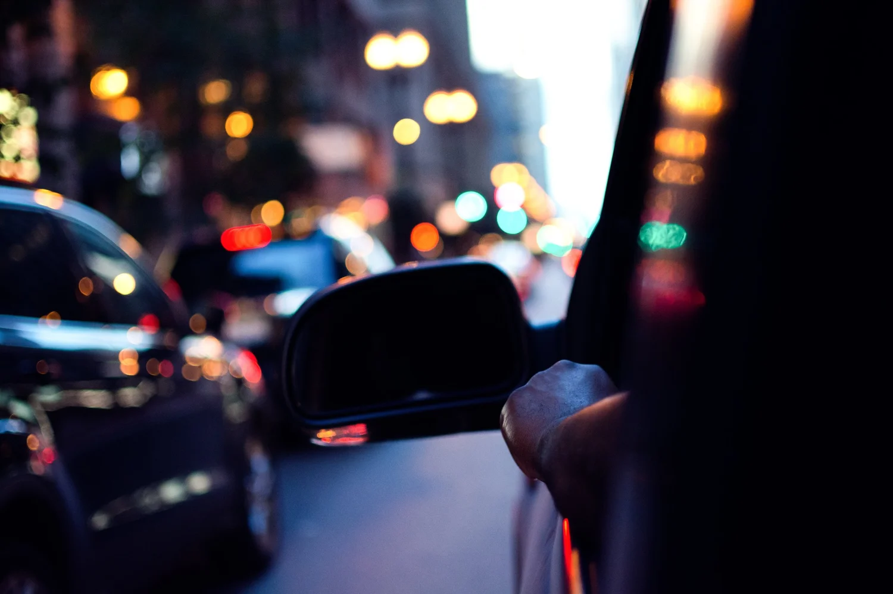

# Thug Cry

*♬ Came from the hood, ain’t nothing changed/ Still lemon pepper on my motherf\*ckin’ wings*

Last Monday night was stressful.

& by stressful I mean annoying.

Lettuce' start with calling Mrs. TramueL before leaving work. I'm leaving later than normal (which is already later than most) I also have to catch a later bus.

& that is the purpose of my call.

She is with Brian at Geneva's school waiting for her to finish rehearsal. Two things normally come from my "I'm leaving work now" phone call. *What are we going to eat?* (Read: What are you going to cook) and if I heard/read about so and so?

& every night I say, can't this wait until I get home? I'm trying to catch the seven o'clock bus.

Given the lateness of my call, the proximity of Geneva's school and the degree of hungriness a rational (Read: Non-hungry person) might have suggested to come through, grab me, grab something to eat and everyone wins.

No.

Part of the reason I ride the bus is road rage, I'm easily vexed by inconsiderate drivers, I mean why can't they be more like me? Also, cheap. Parking in Uptown Charlotte is mad crazy son. When I get home, everyone is hungry, no one has decided on what they would eat. I say I'm out, just going to throw a Bubba Burger on the grill and chill. They don't want that and decide on chicken wings.

& by decide I mean, forty-five minutes later they've decided on wings and it takes another thirty minutes to decide from where.

Listen, they passed at least five wing places on the way home but you ain't read that from me. A felony of the human spirit and the prison it inspires. Mrs. TramueL places the order online, looks at me with those beautiful brown eyes "Babe, will you go pick the wings up? I'll watch your burger." Out loud I say, "'pick the wings up' is a super superlative." (In my head I say) ... "I'll pick them up if you let me pick you up later."

Heavy, heavy sigh.

Every day I have to hear why they are tired and can't do something and everyday I give them an example of what I do. Every. Day;

5:00 AM - Wake up, hop up out the bed ... swag already on.

5:30 AM - #RunLiftCrunch at the YMCA

7:00 AM - Walking the Human w/ Maestro 1.5mi walk through our 'hood.

7:45 AM - Break. Fast.

8:30 AM - Faux getting ready for work

9:20 AM - Walk to bus stop

10:00 AM - Work, an inescapable reality. (Here is where I believe they believe its all fun and games for 8 hours)

6:30 PM - Call to say I'm catching the 6:45 PM bus. Me: "Love you, see you in a few." Mrs. TramueL: "What are we going to eat." No salutation, no well wish, no love.

## The more we do, the more we can do.

Point. Counter Point. I go because' love and shit.

Five minutes on the road, a car is going 5 miles below the speed limit and indecisive about what turn to take. I'm super patient because I'm aware that I'm already on edge. When I'm a few feet away form the wing joint another driver is indecisive about what they're going to do.

Just a note of importance: I'm heading to Buffalo Wild Wings, it is in Uptown Charlotte attached to the Nascar Hall of Fame. Both locations were vandalized during the protest after the *murder* of Keith Lamont Scott.

The other side of the street is closed to parking and 'this' side of the street has limited parking but the parking garage is free for patrons. The car turns on the right hand turn signal to turn into the garage, I accelerate to go past and park but they keep going straight too. Still I remain in control because I'm still aware and shit.

I park well in front of any other cars, because I'm trying to get my 18k steps for the day. No cars behind me, no cars in front of me with plenty of space in either direction. Walk up to the door of Buffalo Wild Wings, pull the handle and realized the door is chained. I walk in the other door, security guard laughs and says "its chained for a reason" ... I look back and the door is boarded up from the inside, the outside had tint and it was dark because my family decided to eat at 10:00 in the pm on Monday night, I'm still aware but not amused so I say "Oh, why is that? (with a straight face)" and mumble something very mean under my breath. Still aware but slowly starting to not care.

## Just because you're aware doesn't mean you care.

Get to the counter, no greeting, no well wish just a "You already ordered?" Me: "Hey, how are you?" "I'm doing well, thanks for asking." "The order was placed online, either for Michelle, Tramuel or Brian."

"Oh, what did you order?"

Blank stare. Blink. Blink.

The rest of the exchange was just poor customer service, you've experienced it ... no point in writing about it. I want the *Chic-Fil-A effect* when I go to places. Be sincere even if you have to fake it. Also, part of the reason I stay home more and go out less. Tired of spending money for bad customer service and food that taste better when I make it at home.

I George Jefferson walk out with a fuck you and have a nice day.

Heavy, heavy, heavy, heavy, heavy sigh. I get to the car and there is another car directly in front of mine. I want you to understand how many empty spaces I walked by to get to my car and the number of empty spaces in front of my car. It is not rational y'all. I notice they are still in the car, heavy tint on their windows but driver side is rolled down a little. I back up, pull out, slow crawl, roll down my passenger side and laser beam side-eye the driver.

It doesn't stop there. I'm immediately behind another indecisive driver. [(Otis Scream](https://www.youtube.com/watch?v=BoEKWtgJQAU)) Left turn signal on but they turn right. After this I honestly don't know how I got home, it was a blur.

Jesus took the wheel, maybe.

No lesson here folks, no message, just the sudden and unexpected end.

Harm none,

B.
