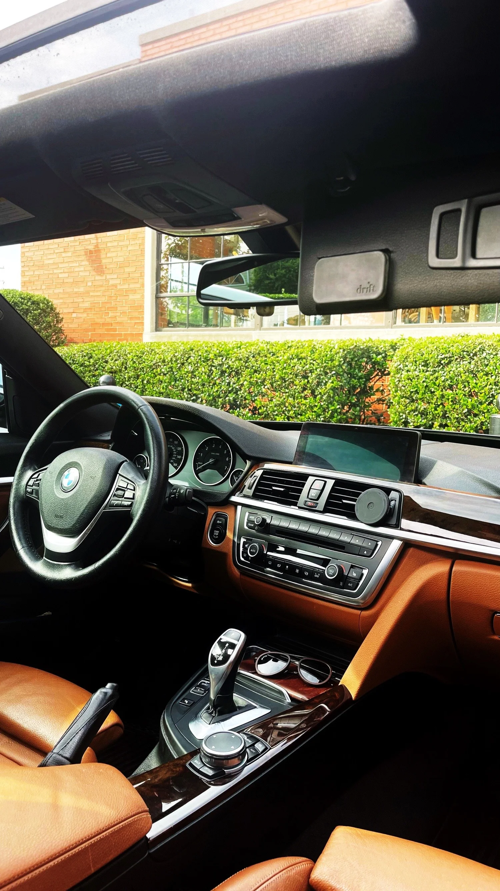

Whenever someone hops into Reese Cup they comment on the smell. I don’t have the official stats but understand there aren’t a lot of folks in and out of her.

Pause.

I can count on two hands how many people have ridden in my car so I’ma say 10 outta 10 riders love the smell.

I use a Drift *stone freshener*. I’m not gatekeeping, also I’m not the plug. Govern yourselves accordingly. I’ve turned The TramueL Formerly Known As on, even tho’ our styles and taste differ, it hasn’t stopped her from modeling her life after mine.

Lol, I’m just serious.

I have platonic friendships with women and I, being a willing conduit into the world of men, suggest ideas, and gifts that their significant others would appreciate, but niggas don’t listen. They would rather it come from some random TikTok or IG influencer. Your man don’t want that shit.

I was chillin’ with this 7 outta 10 the other day, you know the usual … and she told me I had expensive taste.

Deep

Deep

Deep

Deep

Deep

Deep

Deep

Heavy sigh.

I almost went into a rapid speech about quality over quantity and buying things to last … instead, I asked her to tell me more about her $60k car.

Check, this is why I’m not your,

Mate.

*I Am attracted to physical, sensuous beauty, whether in art objects, nature, or people, the lure of color, shape, form, and texture, and the intriguing sounds of music or a voice. These push my emotional buttons and bring me creative inspiration.*

That is my *About Me Blurb* in use on a photography site.

After the $60k question she caught on and we got into some emotional polemics. I’ve shared with others that I spend money on things that enhance my life, things that are functional and help facilitate the things I Am attracted to.

The car freshner comes with a magnetic visor clip, so it is out of the way, not hanging from your rear-view mirror, or sticking out of a vent, and the smell last for 30 days (until the next one arrives), this subscription cost me $10 a month.

You spend that on lunch on the daily.

I enjoy cooking at home opposite eating out, so I have kitchen gadgets to accommodate this. I enjoy Movies and TV in 5.4.1 Dolby Atmos, so I have the TV, and audio surround system to accommodate this. I know this goes beyond material items because I’ve turned so many women on, also I’ve turned them on to the products that I use daily. Anything from the food brands that I buy, wine, cooking techniques, technology, non-luxury brands that make quality goods, routines, habits … infinite.

Listen, this isn’t me bragging it’s just me writing. Someone asked how I B’ knowing and it is like the “I didn’t know you were 52” nonquestion that they want an answer to.

How am I able to defy the effects of aging? Asked disrespectfully.

The formula, respectfully…

Immerse yourself within the flow of information, beyond the scope of TikTok and IG influences. Find worthy news sites, blogs, newsletters, and people who can challenge you without insulting or demeaning you.

Broaden your social networks, this is hard for me because I don’t like white people. However, I am surrounded by a very diverse, albeit small, group of friends.

Get to know your Hardware, I’m deep in the Apple eco-system. I’m also above average maximizing the products that I own and getting the most out of them. Again, using technology to simplify and enhance my life.

Load up on software, reading is FUNdamental, there are graphic manipulation programs, language learning apps… this shit is free. You don’t need to buss’ your gun to get it.

I follow the same rules with sharing information as giving advice,

I don’t… unless explicitly asked.

My feelings are easily hurt when you don’t follow my advice, for this reason, I give up conversation but don’t say nothing.

My logic is undeniable, listen to me now and believe me later.

I Am
