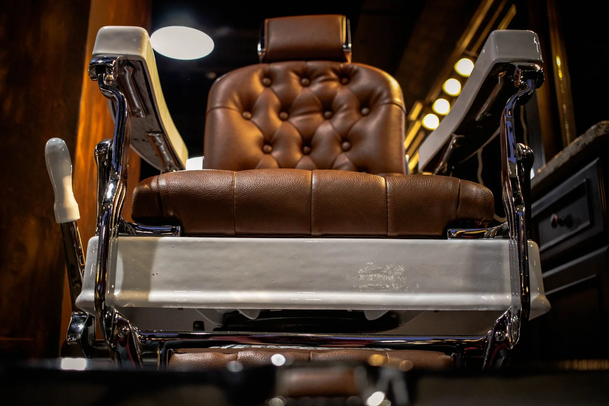
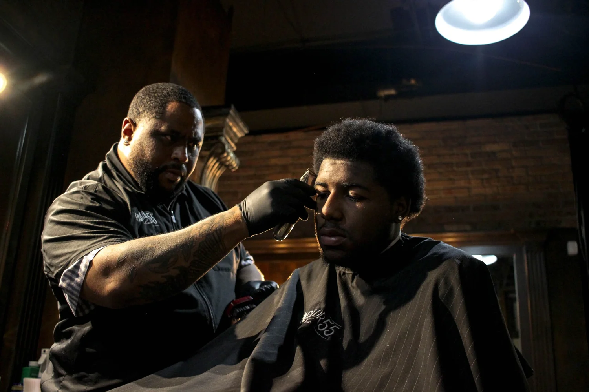
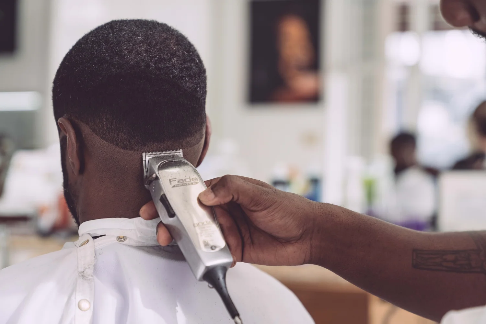

## **Sealey's Sanitary Barber Shop, Established 1945**

In an article published in *The American Scholar,* Eric Fridman wrote, "The success of a barbershop is more than a testimony to the skills and courtesies of its owner. It also bears witness to the barbershop's importance as a ritual place where the private and public concerns of men conjoin to create an experience of psychological comfort, social significance, and simple masculine pleasure."

I started working in Uptown Charlotte in June 2002, it may have been a few months before this that I received my first haircut at Sealey's. It was located on S. Brevard at the time, diagonally across from what would become the Spectrum Center (Arena). I am a creature of habit and my search for a barbershop was not arbitrary or inconstant. I believe I moved to Charlotte in 1998, so it took two years of a few different barbers before I found an agreeable barber, Jerome "J" and barbershop, Sealey's. Repetition and consistency come into play, so when J' told me he was moving his shop to another location and inquired if "I was in" without hesitation, I said yes not even considering how far the new spot would be. Thankfully, just a few miles away. Men ordinarily stay committed to the same shop for years, often for generations. We don't shop barbershops.

## **Sensory**

Barbershops are a physical place that draws on the senses and on tradition. And, although the cultures and climates differ greatly, the physical barbershop and the smells, sights, and other experiential dimensions connected with the haircut experiences were very alike - as evidenced by me strolling into a few non-black barbershops on the strength of the "physical place." A personal observation regarding this, no one in those shops is able or maybe they were unwilling to even try to cut my hair but I've witnessed J' and other barbers in the shop cut anyone's hair that walked through the door with great skill.

## **Money is Talk**

From my very first haircut in Roanoke, VA at a neighborhood shop down the street from my childhood home, Barbershops have become a locker where men can be open and free to discuss the issues of the day or remain quiet. They are breeding grounds for discussions and social interchange. I am convinced that the barber, the man in the chair, and those (even those remaining quiet) awaiting their turn, all benefit from the neutrality and (sometimes) non-judgmental conversation. The talk is not nasty or cutting, it's typically men being men; talking sports, religion, relationships :read: women, local and national politics.

## **Masculine Energy**

Finding a neutral place where men feel a sense of independence and social equality, lacking in economic pressures, provides protection and a healthy environment for open communication and the exchange of individual ideas. Sealey's has remained untouched by the new operations in barbershops. It is still cash only and no appointments. Titles and income levels do not dictate priority or preference, as it does not matter if you are the banker, business owner, custodian, or truck driver, you wait your turn.

A few years ago I tweeted about J' being out of the country for a few weeks and although I could have waited I chose to try someone else. It was during the Christmas and New Year's holidays so I wanted to stay

### F. R. E. S. H.

Michelle, seeing me struggle with waiting or staying F.R.E.S.H., purchased me a gift certificate to a grooming lounge. The experience itself was memorable. My shoes were shined while I was being serviced, hot towel on my face, my scalp was massaged and my hair washed after the cut

*but*

the barber went entirely too far back on my hairline, and too far in on the line of my beard. Everyone was super impressed - the lines were razor-sharp, the cut was nice (to them) I knew, however, that I either had to maintain this horrible cut or there would be hell to pay as it started to grow back. Don't take my word for it. When J' returned his first words were "What did you do?" Lol, I'm just serious. It took 4 visits to get back to close to normal.

> I haven’t used anyone else for about 10 years. How important is this relationship? He & his wife were the only ones outside of family and three close friends invited to our wedding.
>
> — Brian TramueL (@MrTramueL) [December 14, 2017](https://twitter.com/MrTramueL/status/941261518989127680?ref_src=twsrc%5Etfw)

> All of that to say I have a Gift Certificate to Emerson Joseph. Really don’t trust anyone else for a cut so I believe I’m going to try one of those beard facials and just have them line it up.
>
> — Brian TramueL (@MrTramueL) [December 24, 2017](https://twitter.com/MrTramueL/status/945061365210808325?ref_src=twsrc%5Etfw)

> F.R.E.S.H. (at [@EmersonJosephNc](https://twitter.com/EmersonJosephNC?ref_src=twsrc%5Etfw) in Charlotte, NC) <https://t.co/KE3xONEpu3>
>
> — Brian TramueL (@MrTramueL) [December 28, 2017](https://twitter.com/MrTramueL/status/946443051630780416?ref_src=twsrc%5Etfw)

> Fly.  
>  
> In the wind after this cut & beard line up. [pic.twitter.com/xQW2j2j9rv](https://t.co/xQW2j2j9rv)
>
> — Brian TramueL (@MrTramueL) [December 28, 2017](https://twitter.com/MrTramueL/status/946451129352839168?ref_src=twsrc%5Etfw)

At some point these tweets of hope turned to despair as I envisioned having to find another barber eventually, the image in my head was retirement due to a decrease in skill because of aging.

## **More Than Just A Barber**

The personality of a barber carries with it the opening for the barber himself to become an adviser and friend. He is a weatherman, he is a sport and news reporter. He hears confessions. He gives advice.

How do you replace something like that in a culture?

Today while I sitting in the barber chair, J’ told me he was retiring. The shop was closing permanently effective immediately. I could not have imagined retirement just a few years later than my envisioning, especially not due to decreased skill. My first reaction was selfish in that I thought, "what the fuck am I going to do" however I quickly shifted that energy making sure he was good. I am genuinely happy for him.

Life is and will be good.

I finished up somewhere before 9:00 AM EST, at 11:40 AM EST J' called me to tell me that I was the last customer at Sealey's Sanitary Barber Shop, Saturday, May 23, 2020.

Magic Always,

B
