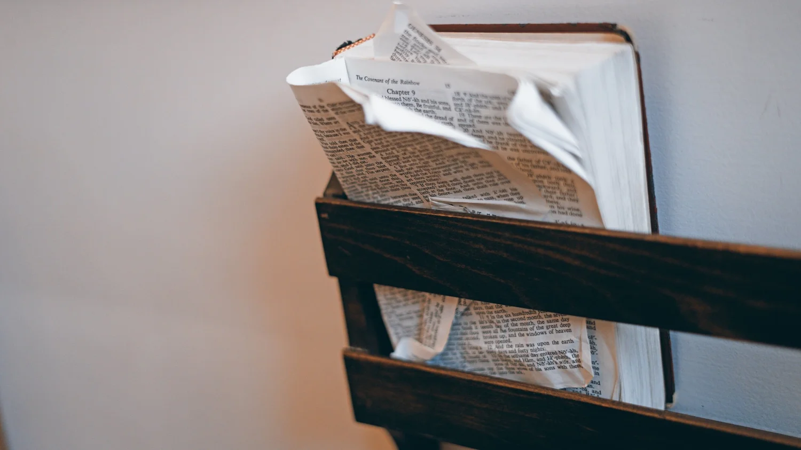

The other morning Mrs. T and I had a ‘difference’ about some insignificant thing, at the time it was not as insignificant as I hopped in the shower, got dressed and went to see a man about a horse. I honestly do not remember what the thing was, I do however remember thinking that most of us operate under the assumption that our way of doing life is mostly correct, and others’ ways are varying degrees of wrong.

It was on a Sunday so I Am going to preach; an assumption similar to the way churches place a strong emphasis on the rightness of their faith and practice while other faiths or denominations are a little bit or a whole lot off.

This approach toward life and the convictions on which it is founded can become a part of the junk we collect and pass on. Have you ever considered why you do / don’t make your bed? or why you refold towels because someone didn’t fold them the way you like?

***“I don’t care how others do it; this is how we gon’ do it”***

This is the way.

Unless we open ourselves to change; moving in a way that reminds us of the relativity and self-locality of (our) truth while affirming that others are absolutely entitled to their own perspective, we will pass on those same beliefs to others.

I Remain
