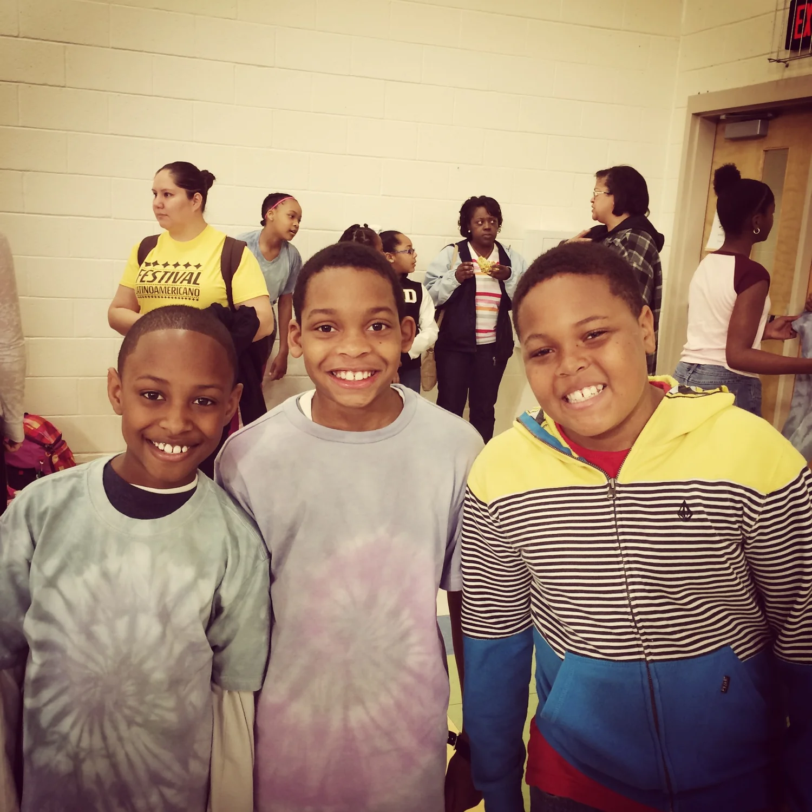

I started a new role with my current employer three weeks ago. In any social or business setting when we meet new people it seems natural for us to begin with the usual conversation starters. Excluding the most common small talk of weather and sports, most living souls never vary from the script. In the words of the late versifier Christopher George Latore Wallace; what’s your name, what’s your sign, what your interests are, who you be with, things that make you smile, what numbers to dial.

I identify as an introvert, although the image of my personality as seen by others may appear more balanced. I say identify because I Am aware that I minimize contact with other people, tend to be preoccupied with my own thoughts/ feelings and mainly have motives and actions that are directed inward. This morning The Future and I dropped Brian off at school for an overnight field trip. The Future made her way around the gym, engaging in conversations with the other parents, politicking about life and all of its ironic twist. I smiled as introductions were made, replied “nice to meet you” and stepped back. The Future is an extrovert, perhaps opposites do attract.

## Silence, a Love Story Starring Me

If I could be alone and in silence sixty-five percent of the time, I would. However I’m grown, with a Future, kids, family, work and a dog… so it’s not an option, life rarely allows silence and solitude.

Below I’ve listed the most memorable take away(s) from my observations over the past three weeks.

## Sound Bite(s)

### Of Health

During a conversation concerning healthy eating with a co-worker we talked about becoming vegan. His experience has been that it is more expensive but his motto… “Pay for it now or pay for it later.”

### Of College Degree(s)

Everyone in my new role prides themselves on their degrees or maybe its school spirit; smells like teen spirit. I Am aware that no degree is required for intelligence. The smartest people I know don’t have degrees, they deal with challenges in the same way that someone who does… with effort, help and hope.

### Of Running

This conversation centered on youth basketball, winning and perfecting the fundamentals. When we speak of fundamentals inherently it is understood, but as my co-worker points out we overlook the fundamentals of running. Running well is a technique just like dribbling a ball or shooting a basket

### Of Idioms

“Yeah, yeah, yeah.” “Right, right, right.” are used so much at work that it is hard to determine if the person is saying “Yes, I've heard this before, you don't need to keep repeating it." or confirming their agreement. The greatest gift of language is that of never using three words when one will do.

I Am
