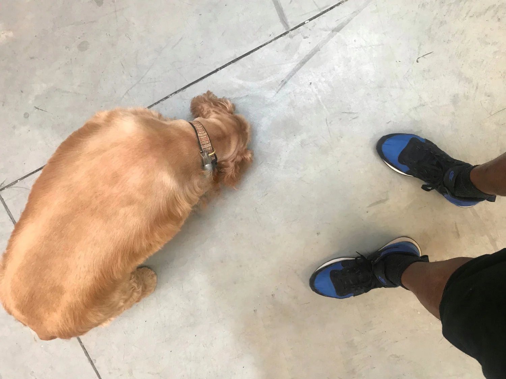

I’ve been a member at the Stratford Richardson YMCA since it opened its doors in 2007. Over the past 52 weeks, I have been in there no less than three times per week. Previously I’ve commented on co-workers whom I share space with.

& although we have worked on the same floor for more than three years they have never parted their lips to say hello, offer a well wish, greeting or a salutation.  The same is true for a few of the faces I see at the YMCA – Faces I’ve seen no less than three times per week for the past 52 weeks.

At times I look at myself and wonder if I Am unapproachable but that trouble never last too long as I apply the famous principles given to us by the prolific raconteur Warren G and regulate.

### **The Art of Self-Regulation**

I incorporate the practice of non-dogmatism; I regularly use expressions where I Am reminded of the relativity and self-locality of truth and affirm that each person is entitled to his or her own perspective.

### **Science**

Side note: You would think people with common shared experiences would, at the least, be able to speak with a glance. The way dog walker’s smile at each other when passing (is that where dogmatism comes from?)

This morning both worlds came together; work life and gym life at another commonly shared experience, coffee – Keeping in line with the dog theme, I had Maestro with me at Not Just Coffee – the woman behind the counter completely enamored with him. It became infectious and spread to the other coffee seekers – also spreading to the co-worker and the gym-goer.

I, the pettiest of Virgos ignored their smiles and feeble attempts at believing there was anything that connected us, grabbed my coffee, thank the shop and George Jefferson walked out of there.

I remain,

(Petty)
