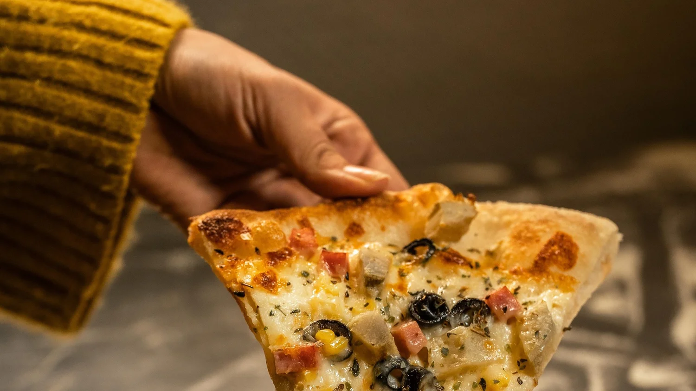

When I began to prioritize my health, all of the healths: emotional, social, spiritual, environmental, financial, occupational, intellectual, and my favorite sexual... I noticed that some people started to fill in the blanks with their ass umptions and narratives. & by some people, I mean women, some would *"Lol, I'm just serious"* me to death, referring to my structured lifestyle as having a really big “*team*,” suggesting I'm juggling multiple situationships. The reality? I'm just at home, focused on my goals, in bed by 8 in the PMs.

### **Time & Health**

are two precious assets that we don't recognize and appreciate until they have been depleted. Dig if you will a picture, let me paint it of what's really happening with my time. When I decline a last-minute evening invite, I'm not out with someone else. I'm likely meal prepping, juicing something, or winding down for a 5 in the AMs workout. These aren't excuses, they're intentional choices that shape my daily routine. This is what it sounds like when doves cry.

### **My boundaries aren't walls**

they're frameworks that support my goals: Early bedtime for proper rest, and pre-dawn workouts for weight management and muscle building. Dedicated time for meal prep and healthy cooking. Regular juicing for optimal nutrition.

### **Structure Isn't Restriction**

Here's what living souls don't see; structure creates more freedom, not less. By maintaining these routines, I have more energy throughout my day, better focus for fake working, improved physical and mental health, and the ability to be fully present when I do socialize.

### **The Spontaneity Myth**

Contrary to what folks think, having structure doesn't mean I can't be spontaneous. I love breaking bread, having drinks with friends, and going on $200 dates. I simply prefer planning these moments ahead of time. This isn't about the introvert or the Virgo in me; it’s about ensuring I can be fully present, engaged, and authentic in every interaction. For every hour I spend with someone, I gotta spend 24 hours alone, that’s the introvert or Virgo in me — probably.

I love eating the p

### **Told This Woman I Was A Star**

That's why she only sees me at night. So no, there's no team. There's just me, my ego, and my commitment to improving my health, all of the healths. Sometimes that means saying no. Sometimes that means being in bed while others are starting their night.

Baby, I'm a star and that's okay.

> *Drop it to the floor, make that ass shake. Whoa, make the ground move, that's an ass quake. Build a house up on that ass, that's an ass-tate. Roll my weed on it, that's an ass tray.*

### **What others see as limitations**

I see as ass sets. The most important relationship we have is with ourselves, and that relationship deserves time, attention, and yes – structure.

No Face, No Case.
