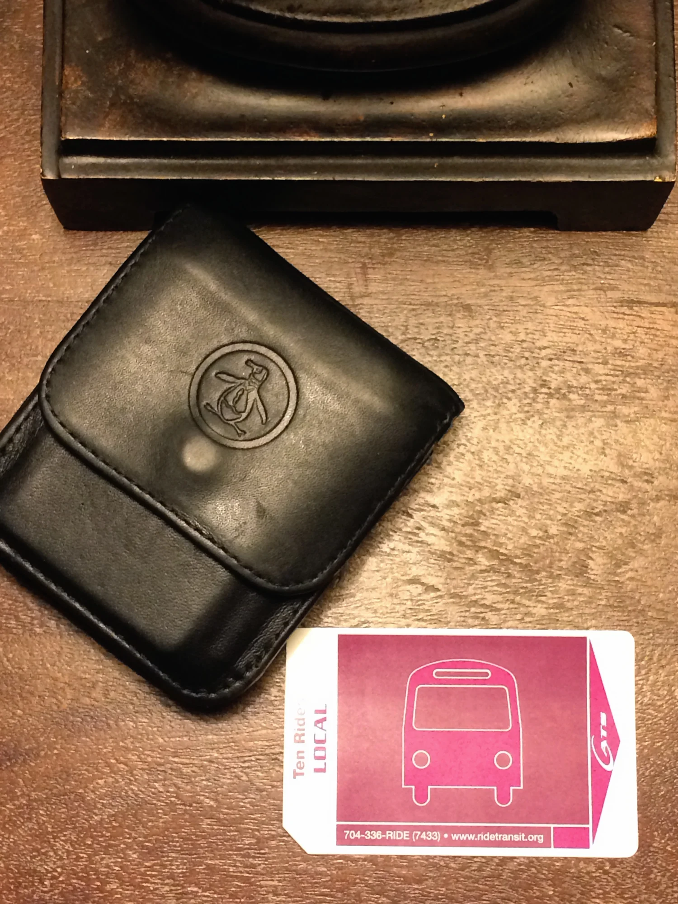
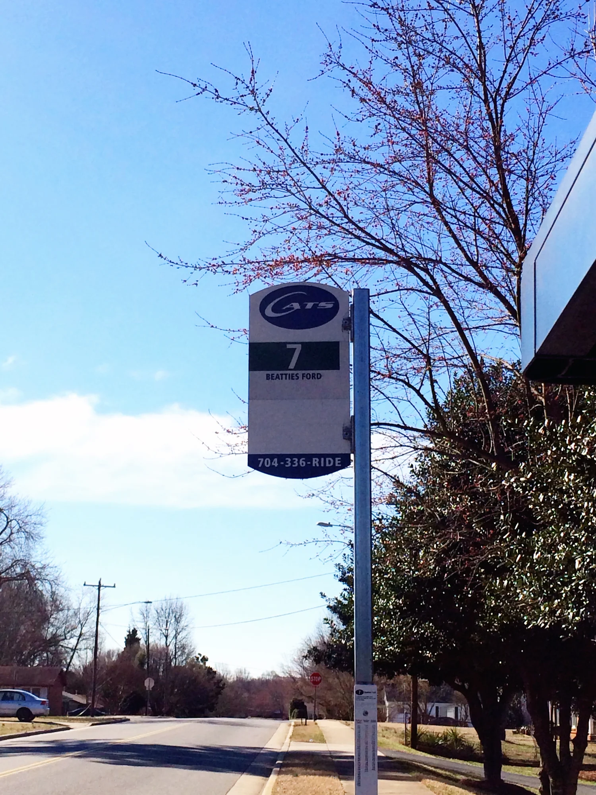
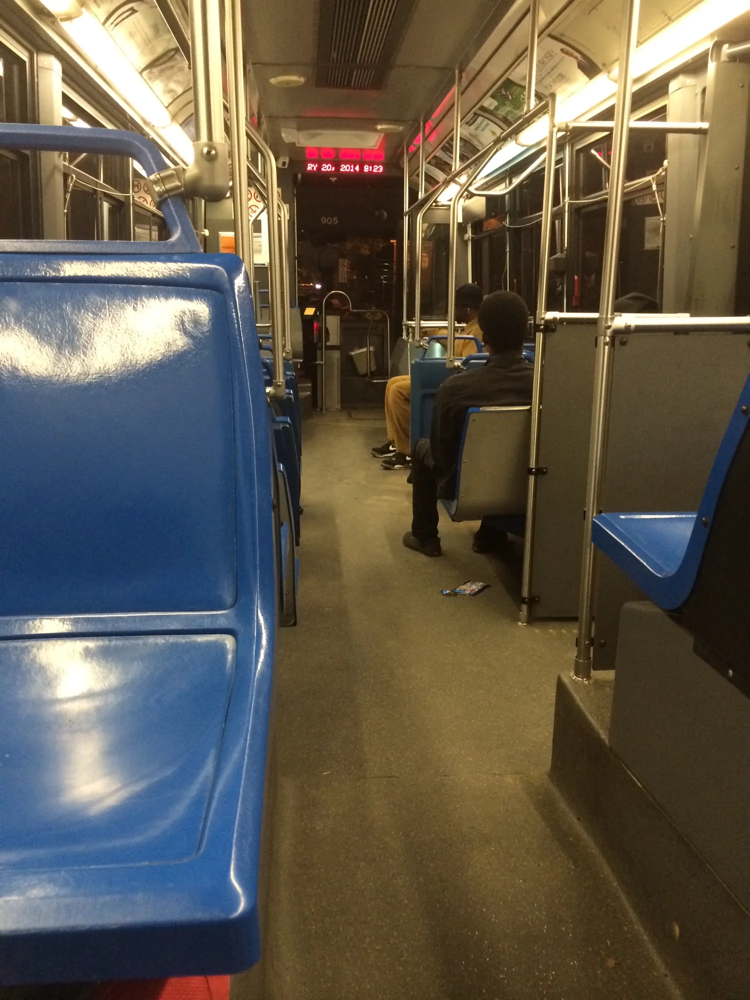

A little over two weeks ago the TramueLites were down to one vehicle while the other was being serviced.

First world problems.

The merciless god of perfection aligned the stars on this day; everyone having to be in different places at the same time. I was working an alternate schedule that required an earlier in-time, Brian had tutoring before school, Geneva had choir rehearsal before school and Michelle had to sharpen her sleeping skills. I’m kidding [because sometimes she reads my post], but no seriously. She chauffeured the kids and I rode the city bus.

## & I've taken the bus every day since.

The time equalizes itself; twenty minutes extra in the morning = twenty minute walk from the parking deck to my building. Fifteen minutes extra in the evenings = fifteen minute walk to my car after work. The only way to explain the five minute variance is that it's always faster on the way home. I believe I tweeted my anticipated savings would be $Forty in monthly parking fees, $Fifty [on average] in bi-weekly gas savings. My math is adding up and holding true. Also, I’m using pre-tax dollars via [WageWorks](https://www.wageworks.com/) to purchase an already discounted 10 ride bus pass so the savings is even greater.

## Point. Counterpoint.

In the last year, I’ve adopted wearing headphones everywhere. Not only while exercising but while I’m working, walking and shopping. I do realize this makes me reclusive, but music helps to drown out the sound of the chaos of the world. The time on the bus creates space, a space for observation; there is more to the world than what is before our eyes. I Am aware of the stigma associated with riding the bus, perhaps this is something that is embedded in our subconscious. However, I do not share the same reservations as others. My experience in the Queen City has been contrary to slow, unreliable, inconvenient and uncomfortable. It has been cheaper, faster [in some instances] and has provided the perfect space to read, listen to music, observe or at the least sharpen sleeping skills. Although I wouldn’t recommend this, stay woke… literally and figuratively. What I’ve learned over the past two weeks has nothing to do with race or class [the biggest stigma(s) concerning riding the bus] but everything to do with autonomy.

## My most memorable moments from the past week…

“Do you have a personal hotspot on your phone I can connect to?”

There is an attractive young woman who gets on a few stops after me. Every day someone attempts to spit mad game son.

I am quiet and ride with a sense of peace; this always attracts folks with the opposite energy. Because it doesn’t matter that there are 20 empty seats, the person screaming into their cell phone always sits directly in front of me.

> "Words like yid and kike and kikey and nigger and coon make me kind of sick, no matter who says them." - Moss Hart

## On the ride to our destinations, all any of us want...

to be treated with respect.

our personal/physical space to be respected.

the space to read, think, or listen to music.

saying no when appropriate.

not reciprocating interest in someone who is interested, whether they are persistent or their feelings are hurt. You are not responsible for their feelings, only how you advise them of your disinterest.

I Am
