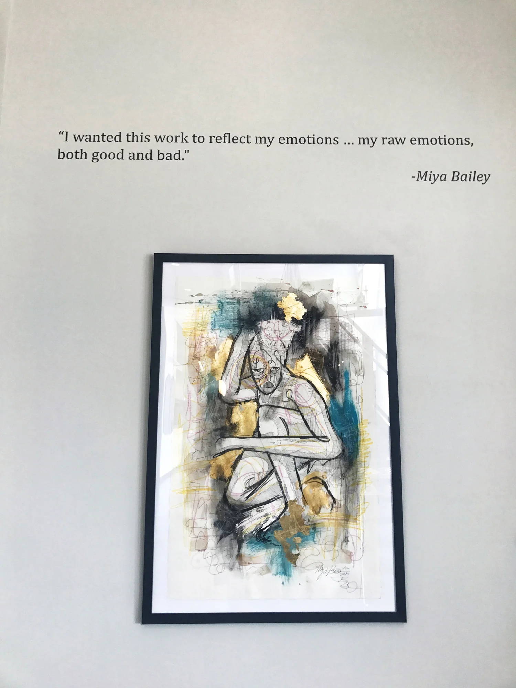
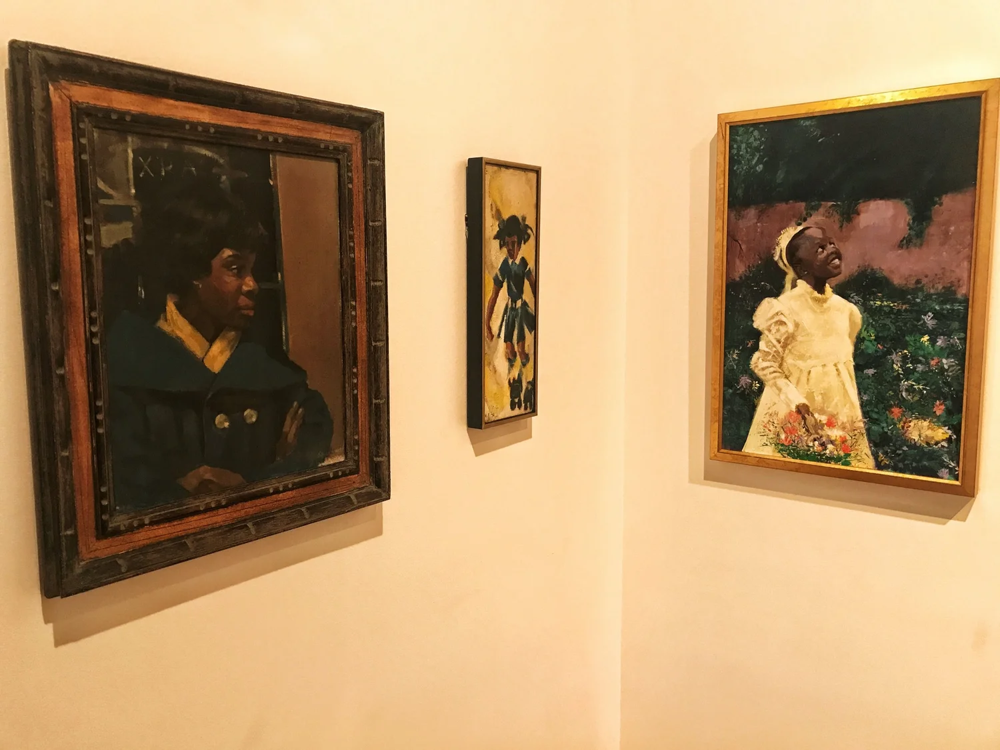
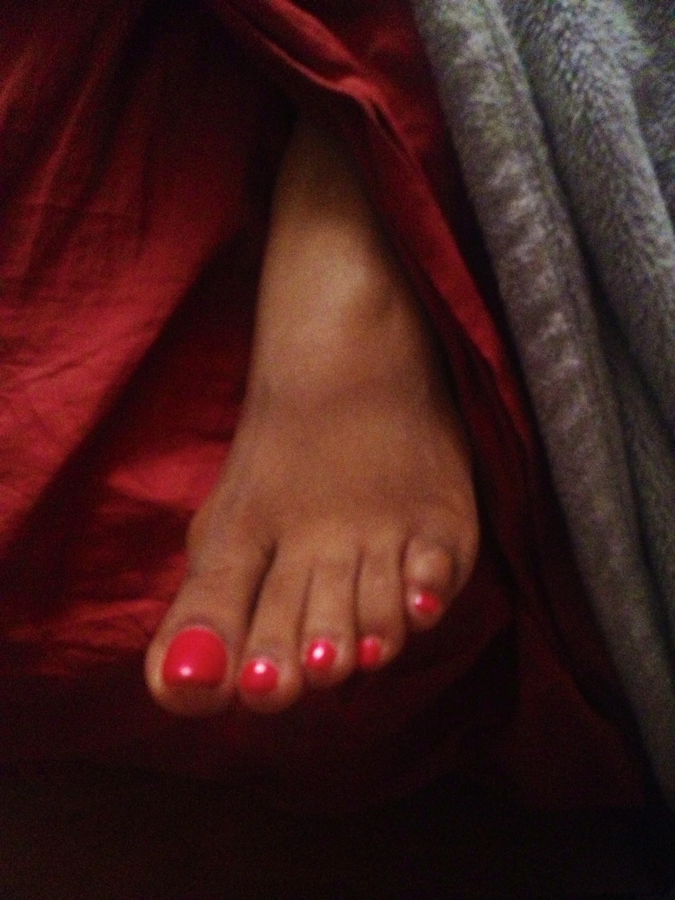
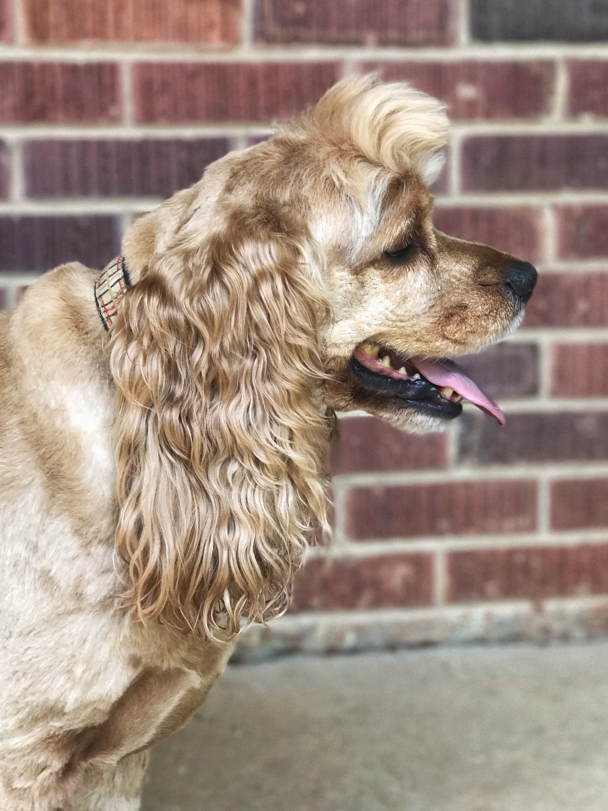

This weekend there were three fantastic moments where time seemingly stood still, allowing me to store them into a mental rolodex.

## Listen to your heART

The Harvey B. Gant Center opened four new exhibitions over the weekend. I know, but I am unable to communicate why art fills us with emotion, I’ve tried to explain but apparently I’ve said it badly.

The walls were lined with [*Immortal*](http://www.ganttcenter.org/exhibitions/immortal/), a new series by Miya Bailey.

There it is, he said it.

Upon entering the first exhibition room,

[Instill & Inspire: Selections from the John & Vivian Hewitt Collection of African-American Art.](http://www.ganttcenter.org/exhibitions/selections-from-the-hewitt-collection/)

The first moment found me standing in a corner enamored and motionless viewing the first three paintings:  
  
Woman in a Blue Coat, Ernest Crichlow  
  
The Presence, Earl Hill  
  
Girl with Flowers. Ernest Crichlow

## A Valentine’s Message

### “Love is poetry and poetry is life.”

The second moment was on Sunday. Upon waking I was overcome with emotion for no reason other than seeing *her* lying next to me; caramel skin, exposed leg, red nail polish on her keen feet and narrow heel. I was consumed with her. Thinking, feeling, believing I could not love her more, my heart was full.

## What Makes You Happiest

Maestro our non-human family member and I hang out a lot, even though I’m not his favorite, Michelle wins that distinction. People are drawn to him wherever we go. Often met with Oooooo ooo oooo's and ahhh ahhhhh's followed by “Oh my gosh, s/he is so cute.” He is secure in his masculinity, so he never trips when being called a she. I'm always asked if he is a good dog, I'm assuming they are referring to the breed. On Sunday, as in any given Sunday, I was asked again and this time, considering what is really being asked, I answered with the enthusiasm of a proud parent.  
  
We have been lucky to have him, he was very easy to house break and he has never had an accident at home or while visiting another. Very gentle, except with Brian because his favorite bone is in Brian’s leg. We never have to crate him and he doesn’t bark other than the normal sensory issue; knocking, doorbells, airplane, thunder or other dogs barking. He is also pretty smart. I know everyone dotes on their dog but seriously he lets us know when he needs to go outside by looking at us as if to say "You gon' open the door or nah?"  Also, on Sunday I could not figure out why some of his (dry) dog food kept ending up on the floor in front of his bowl. Michelle pointed out that I bought the wrong food and it was mixed with the kind that he likes. Looking at the food, how could you know? But he picks out the flavor that he doesn’t like and spits it on the floor. Lol.

With the previous few weeks being uninspiring, this weekend provided the energy I needed to understand that things that make you happy also make you whole.  
  
I didn’t dread Monday at all.  
  
I remain,  
  
Brian
