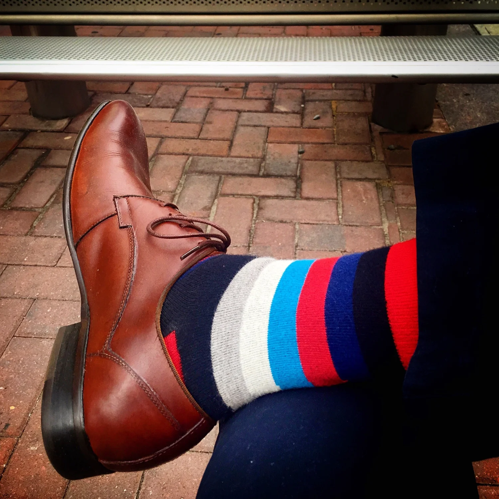

**Vacation and the Art of Presence**

 My family and I squeezed in another vacation a few weeks ago; a mini reunion in Alabama. I have a cousin who is retired military and he was able to secure cabins for us at an incredible discount. Keyword; Cabins, as you might imagine we were surrounded by the outdoors but this is perfect for me. I Am an early riser and on the second morning after our arrival I sat outside on the cabin’s front stoop; my e-reader opened to *Between the World and Me*, but I have no desire to read. There was peace and silence. I was in solitude. My thoughts lead me around my own world. The air is cool. A slight breeze exists, I hear noise but it fades in the background while the music of silence continues its melody. I smell the air, probably the moss trees. I have no schedule and have nowhere to arrive to. I pay attention to every twitch my body makes. I feel alive. I am not worried about a thing. I am not too cold or too hot so I can enjoy the breeze. No one bothers me. I hear my every thought. Nothing is a wrong thought or a wrong answer. I know what to do next. I don’t feel perplexed about life. I revel in every minute.

**Style**

During that time I focused on some of the conversations (brought about by unrelated conversations) involving my youth. [Angelo & Duffy](http://tramuel.com/iam/hometown-glory)  have been in my conscious lately and I laugh often remembering stories from us hanging out. They were both equally charismatic and funny.  I remember how we generally, often unknowingly, established a lot of fashion trends.

“Set trends, don’t follow them.”

My mom remembers that I was recognized as best dressed in middle school and high school; probably more impressed with how I accomplished it than the actual acknowledgement.

“… and he did it with what he had.”

My folks didn’t spend a lot of money on our clothes; I don’t believe it was a matter of not having as much as it was being smart with money. I remember remarking that I didn’t own a pair of jeans until high-school and even then I may have bought them with money I made from my first job at Wendy’s. I did like to “look” good; I was neat, not flashy; clean, organized & put together, not trendy.

**Frugal**

I used to believe this was about my personality; however I now believe that lessons in frugality were sprinkled over my childhood. There weren’t many conversations about money growing up but what transferred was the mindset to live within my means, to take great care of the things I possess, live organized and clutter free and perhaps the thing I’m most grateful is the ability to reconcile needs versus wants. In no way do I always choose correctly, I make impulse buys and splurge on non-guilty items often.  I Am a work in progress and the more I work at a thing, the better I get at my work. The better I get at my work, the better I feel about myself and the work I’ve done.

I still have my feet on the ground, I just wear better shoes.

I Remain
