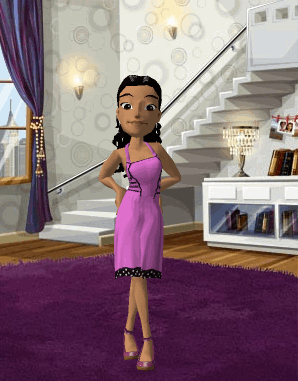

*"She disappears down the escalator, staring straight ahead like a woman on a mission. She swipes her card and glides through the automatic turnstile without pause. The blinking red lights on the platform’s edge indicate a train is coming soon. The train’s door stops directly in front of where she’s standing, as if arriving solely for her benefit. When it opens, she steps through and unfolds the newspaper under her arm at the same time. As if choreographed, her movements seem both deliberate and totally spontaneous. She seems to be doing more than everyone else by doing so much less. Your eye is drawn to her. She acknowledges your presence by ignoring it. She is the personification of cool by annihilating your very existence*."

*- Reserve, Helena Andrews*

*An excerpt from Black Cool: One Thousand Streams of Blackness by Rebecca Walker*

Heavy in these social streets are conversations about attraction. Beard gang, team natural, tattoos, piercings, [insert other highly personalized appearance choices] there will always be something that pulls us in.

Personal truth, I'm drawn to style. I notice personal appearance; colors, hair, the sound of her voice, even the way she walks before I notice good looks or attractiveness.

Your style is fly, maintain your substance.
