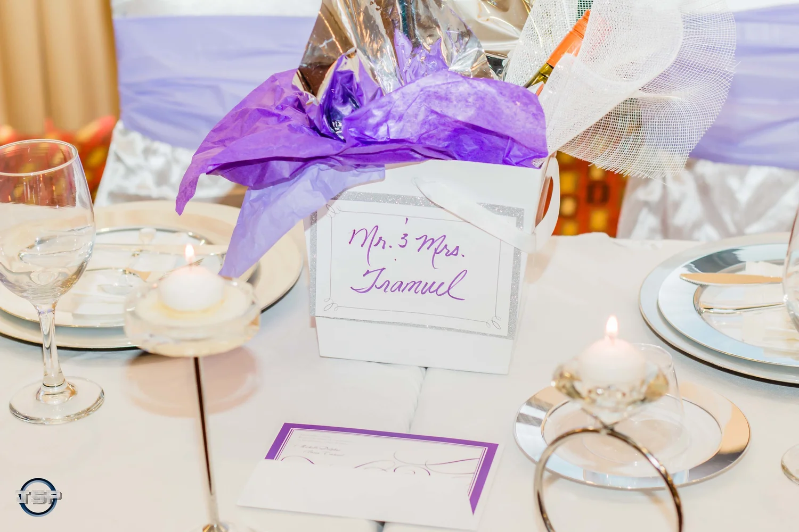
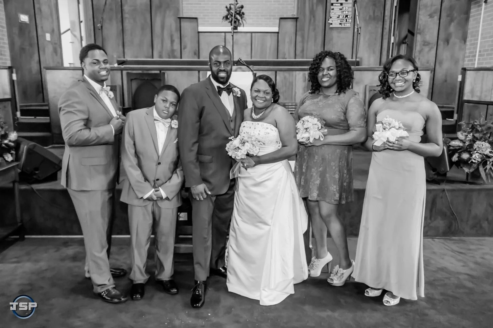
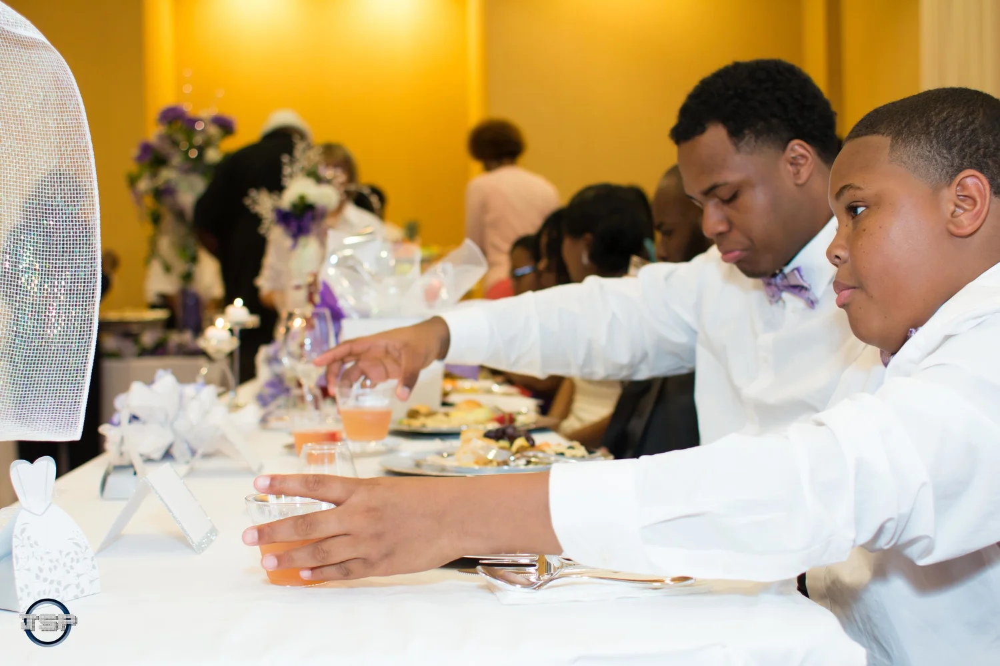
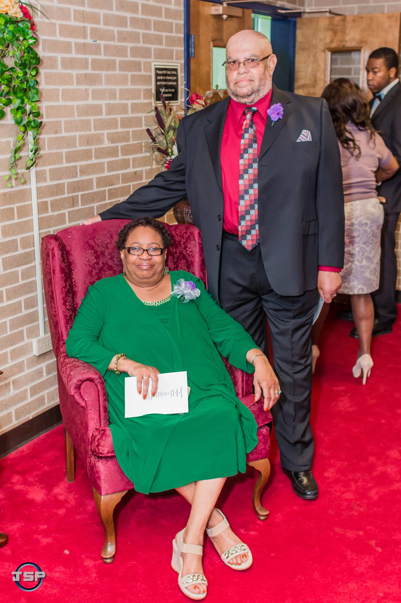
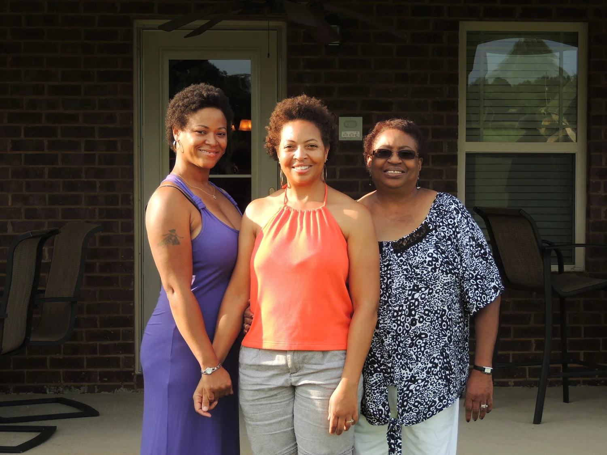

## 2015 Year End Reflection

*Improve relationships, healthy living, write more, read more (less television), increase income, increase savings, find ways to stay in love, practice humility (intellectually, socially and emotionally), get organized (in general, but also finances, insurance & other important records), smile & laugh more, grow spiritually and meditate.*

My “better thinking” goals are just aspects, some of the parts that make up the whole of 2015. Growth and life’s lessons are (were) a consistent theme.

### Of Growth

I had to take the time out and really emote and understand my own needs in order for any of the things listed above to improve.

### Of Life’s Lessons

Being quick to help others, I’ve gotten my hands dirty; not only with mundane tasks but also on an emotional level. At times my insight is sharp and sometimes awe-inspiring.

*That’s not ego, that’s just me writing.*

## The Style and Substance of 2015

**I got married.** Michelle and I joined ‘forces’ in April surrounded by family and a very small circle of friends. Our kids served as the bridesmaids and groomsmen.

**I watched my kids grow.** As I’m writing this (I’m at work) Geneva just called to say “What’s up? I didn’t see you when you came home.” Doesn’t seem like much, however the amount of compassion, empathy, concern, openness, and sincerity that Davina, Aaron, Geneva & Brian possess is amazing.

**My mom got sick.** There is a deep pain; a loss of emotional security, security of the soul upon receiving a call that one of your parents is sick. It was Christmas; I had just spoken with her and my dad, thanking them for the gifts, closing out with “I love you” as we always do. Then another call that she had to be rushed to the hospital, but reassured that she was ok. Then another call on Sunday morning that I should come home immediately. The next three hours were a blur, I’m suddenly conscious as I’m standing by her side.

## Unanimity of Purpose

Almost in birth order we arrive within 30 minutes of each other; I the closest (distance) first, then my older sister and finally my younger sister. Still not understanding what “it” is, looking at my mom, speaking with her as if we are in her living room sitting on the couch.

She looks very well.

She had been written off…

& then God showed up; literally and figuratively. Our family, immediate and extended, provided an incredible show of love, support and prayer.

Finally,

Answers

Recommendations

Treatment.

There is a long road ahead; however there is a unanimity of purpose for 2016 to see her well.

I Am
