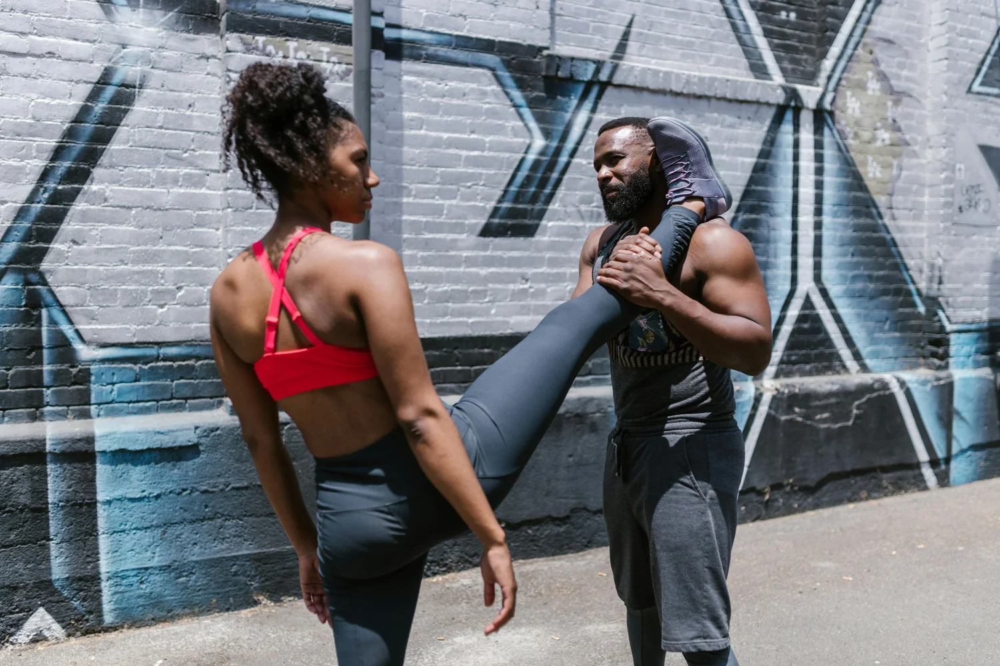

There’s something that happens when I walk into the gym. Not just physically but emotionally, energetically. No music yet, no reps. Just a stillness. Like I’ve entered a space that demands both effort and honesty. It’s not about punishment, not about ego. It’s about presence.

And when I’m present ( ( F U L L Y ) ) I remember that this, too, is sacred.

The repetition of movement feels like meditation. Cardio after weights. The hum of machines. My breathing syncing with each rep, each step. I’ve been showing up for my body like I show up for my people, with loyalty, with care. It’s not always dramatic, but it’s always deliberate.

& in a way, that is a kind of worship. Not of aesthetics. But of consistency. Of self-regard.

The gym, for me, is less about how I look and more about how I feel. How I clear my mind. How I move energy. I walk in with questions and leave with clarity, not always answers, but a rhythm of peace that wasn’t there before.

There’s community here too. Silent nods from familiar faces, acknowledgment without expectation. It’s not loud, not performative. Just people showing up, silently cheering each other on.

We don’t talk, but we see each other. And sometimes that’s all you need, to be seen.

So yeah, maybe it’s not church in the traditional sense.

But it’s communion.

It’s devotion.

It’s grace under weight.

And that feels spiritual to me.

This could be us, but you playing…

With Grace and Grit,

B
