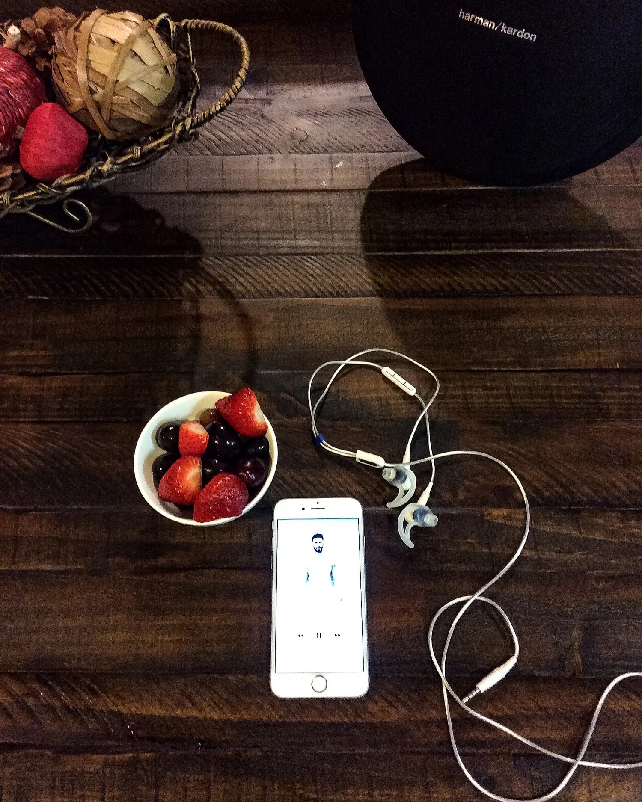

## Wednesday Afternoon Musings

### R&B and Hip Hop Music is Dead is the New Black

We all love things that we have no personal interest in doing, but enjoy seeing (in this case hearing) others engage in and succeed at.

Fan.

Lately there appear to be more critics than fans of today’s music. Turn the radio off, stop allowing social media edicts to influence what you like. I’ve discovered, supported and stan/(d) for artist on Soundcloud and Bandcamp. Recent discoveries;  [Drew Anthuny](https://soundcloud.com/drew-anthuny) [Little Simz](http://littlesimz.bandcamp.com/)

### Having a Roommate Named Mom is the New Black

I drove home to VA two weekends ago with no agenda, I just wanted to hang out with my folks. Being there brought up memories of life in the house and an understanding of why I Am the way I Am in my current home. This led to thinking about friends that are facing current hardships; foreclosure, divorce and their decision to move in with their parents until things are resolved—relating to what someone is saying through commonalities, in turn led me to wondering if I could live with my folks as full grown ass adult. They’re neat, organized, exacting, clean freaks like me so check. They would need to upgrade their internet speed tho’, the real question is would they want me to? They were so at home without any “kids” running around. I’m sure they like the visits but at one point they looked at the clock like “What time do you have to be at work on Monday?”

### "Friends” on Digital Lists is the New Black

I’ve made wonderful connections in these social streets and do not use friend lightly. I mean friend, long before 140 characters, status updates and hearts on images. Everyone doesn’t have the skill set necessary for friendship, it is what it is. How a person responds to your good times and bad times tells you a lot about the relationship that you have.

### Relationship Expert is the New Black

Y’all. I mean. I stopped talking about love because. Nevermind. But y’all gotta stop listening to these sike-ologist.

Love can save the world.

Drew Anthuny, Last Loving Breed

I remain.
