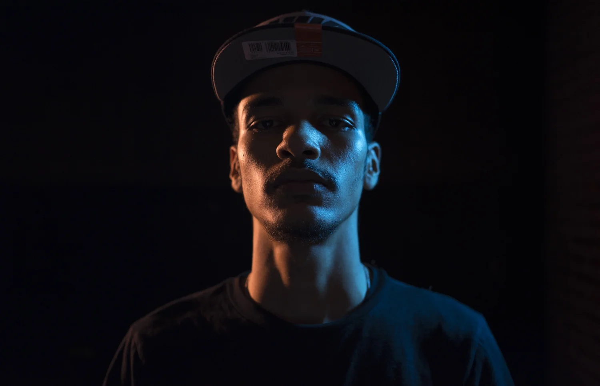

*by Joi Tramuel*

I never seen him in the battlefield.

But I know he was afraid because he had on his uniform.

Melanin equals unicorn.

To their rose bushes I am but a thorn.

So I took my own branches and created a crown.

I wear it proudly as I kneel down,

Presenting my Queen with one of her own.

As we fight this war together our children learn, watch, and grow.

For they will soon take our place.

The more they see, the more they know.

I don't want them reliving the perils of hell on earth again and again.

A march for her and justice for him.

WHEN. DOES. IT. END?!

Calling all gangstas! Calling all gangstas!

There's a brotha hanging from a tree limb!

An evil deep rooted hatred for us is inside them.

My children aren't safe at school.

My Queen is not safe at church.

We know how the system works;

Murder, outrage, then a petition.

DOJ, trial, and no prison.

Once we gather in black it is all over.

As we march to the tomb of the unknown soldier.

Joi Tramuel is a proud graduate of Norfolk State University where she obtained both her Bachelor’s degree in Psychology and her Master’s degree in Urban Education.

Founder of [The Society for Hip Hop & Education](http://thesocietyonline.org/about/), an organization upholding the TRUE image of #HipHop and advocating for community empowerment.
