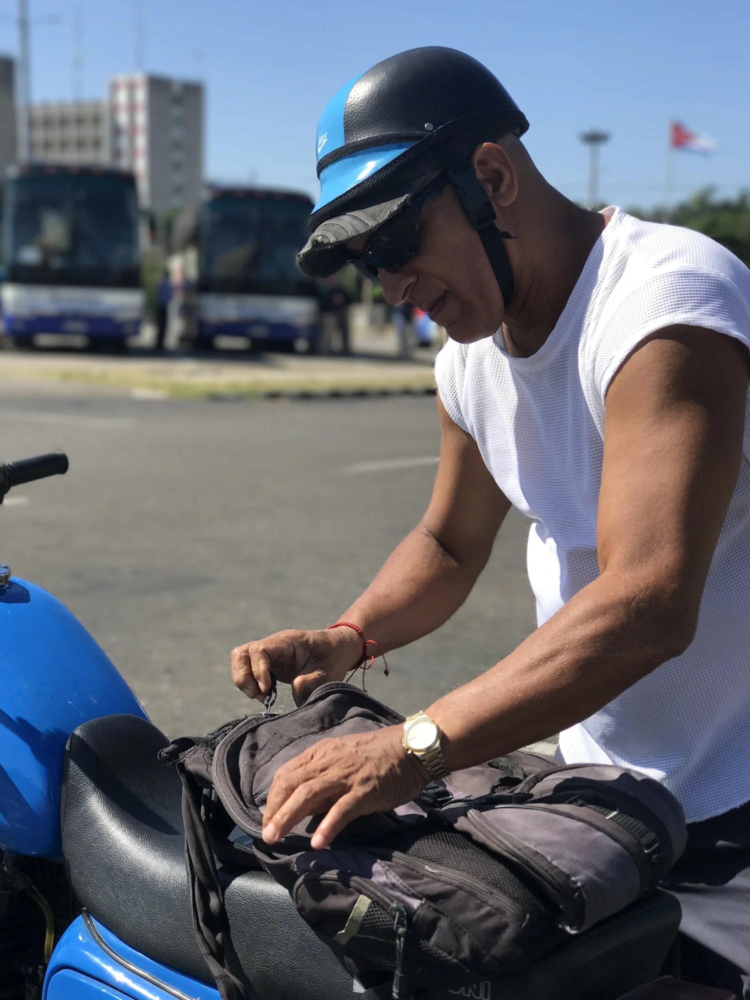
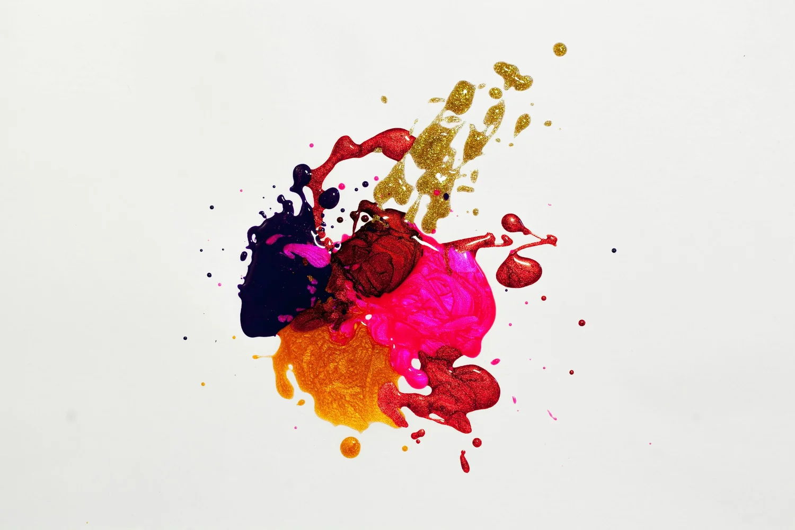
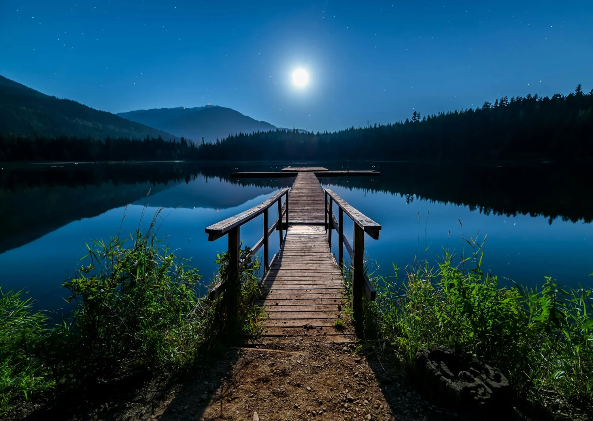

### **Travel Memories**

I was walking along the Malecón, a broad esplanade, and seawall stretching for 8 km along Havana's coast when I met Nelson. His motorcycle was parked in a turnabout, and he was sunbathing shirtless. I was taking a picture when he struck up a conversation, thinking I was Cuban. Nelson told me he had just finished studying to become a tour bus guide and wanted to practice his English. When he realized I was a tourist, he offered me a personalized tour on his motorcycle. I agreed, wanting to explore Cuba beyond the usual tourist attractions.

Nelson took me to his home, where I met his wife, drank rum, and smoked a cigar. We visited several key sites, including the Plaza de la Revolucion, Havana Cathedral, and the Museum of the Revolution. Our most significant conversations revolved around life in Cuba and the impact of the Communist regime, which has enforced salary equality since 1959. Despite widespread poverty, Cubans are proud and well-dressed, often living in crowded conditions with extended families in small spaces. My experience with Nelson gave me a profound perspective on Cuban life, culture, and the resilience of its people.

### **Art**

Art can capture and express emotions. Its multi-sensory engagement and its capacity to transcend the literal constraints of language. Through colors, forms, sounds, movements, and stories, art can evoke deep, often subconscious, emotional responses, allowing us to experience and understand emotions in a rich, nuanced, and universally accessible way.

### **Nature's Beauty**

Photography engages viewers through colors, shapes, and textures. These elements can evoke visceral emotional responses. Different colors can evoke different emotions. Warm colors like red and yellow can convey passion, energy, or warmth, while cool colors like blue and green can suggest calmness, sadness, or introspection. The arrangement of elements within a piece can create feelings of harmony, tension, or chaos. A balanced composition may evoke peace, while a chaotic one can suggest turmoil.

### **Cooking and Presentation**

Cooking is more than just a necessity. It's a way to nurture myself and to experiment with new ideas. The rhythm of chopping vegetables, the sizzle of ingredients hitting a hot pan, and the aroma that fills the kitchen are all meditative, grounding me in the present moment. Cooking is also a form of love, a way to show care and appreciation. Whether I'm preparing something simple or an elaborate feast, the act of cooking brings me joy and a sense of connection to the food I eat and the people I share it with.

The visual appeal of a dish can elevate the overall enjoyment and anticipation of a meal, making it not just a feast for the stomach but also for the eyes. Color, plating, textures, garnishes, and tableware communicate the care and thought put into the preparation, elevating the overall enjoyment of the meal.

Experiences shape our understanding and appreciation of the world in vivid, lasting images. Art captures the essence of emotions, nature's beauty speaks to our souls through its colors and forms, and cooking becomes an act of love and connection. Each teaches us to think in images, enhancing our lives with memories that stay with us forever.

B. TramueL
