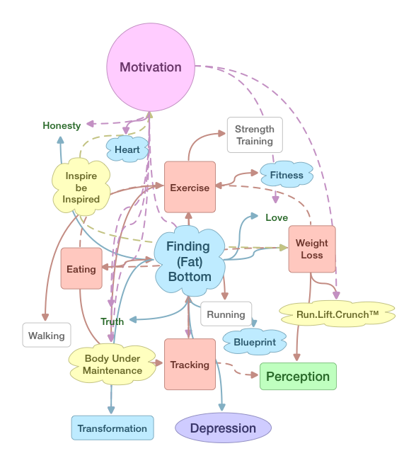

# Pounds

Less than one year ago I tipped the scale well above the title of this post. It is inspiring watching my body change. I Am 15 lbs shy of my (personal) target of two hundred twenty five.

Pragmatic discussions with family, friends and co-workers provided the thought to write this post. While weight was not one of our conversation topics it did share a common denominator.

# Finding Bottom

### Marital difficulties, financial bondage, addictions...

Unfortunately the catalyst for most to change is finding some form of or hitting bottom. My bottom came after an annual physical that revealed high blood pressure, pre-diabetes, high cholesterol, elevated triglycerides and something they have not been able to categorize with my liver.

Why it took me reaching bottom to run with the change monster? Probably because I saw my twenty-one year old self in the mirror. Literally at times. Also, [in my mind at least] this was supported by loved ones who never commented on my weight.

Love without conditions I suppose.

However we all desire growth and development and love demands honesty. It should confront illusions and dare to risk temporary discomfort by calling us to the truth.

# The Big Picture

I've proclaimed myself as the family photographer. I like angles, light and backgrounds that will not date a photograph. Eye TramueL. I was generally excluded from the "family shot" at reunions or family gatherings because I was the one holding the camera. I've been replaced by cell phone, tablet and digital cameras. In addition to finding bottom, I saw an even more vivid image of myself in recent family photographs. In retrospect I wonder if I subconsciously stayed out of those captures.

# Transformation

My biggest motivator has been ego; my sense of self, including confidence, pride, and a sense of attractiveness to others. Am I narcissistic for using this? Don't answer, I'm going to stare in the mirror at my forty year old self until the answer comes to me.

All of that to say, find something that motivates you before finding bottom. Do it now and do it with vigor. Although it is an ongoing process focus on one simple concept...

### Honor your body

The results from that physical have been completely erased, everything... gone. In honoring my body I've followed two rules;  eat healthier; [eat food, not too much, mostly plants](http://michaelpollan.com/books/in-defense-of-food/)and exercise; Run.Lift.Crunch. The benefits carry over and help with everyday stressors, I've learned that a good sweat and a shower relieves stress and leads to a good nights sleep [or other].

I Am

